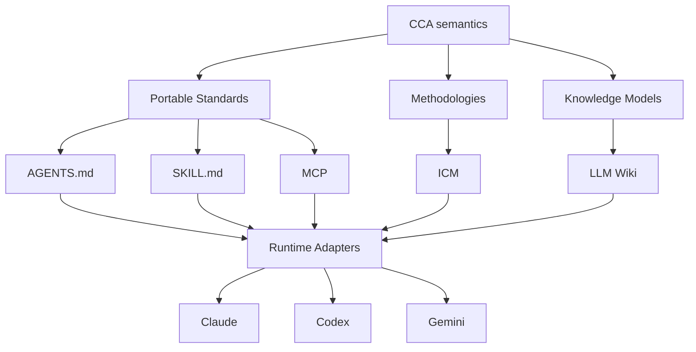

## CCA Contributing Guidelines

Thank you for your interest in contributing to CCA. This document explains how to contribute and where different types of feedback belong.

## Types of Contributions

### Documentation Improvements

We welcome improvements to the CCA Documentation — typo fixes, clarity improvements, standards, principles, better examples, and new guides. Documentation lives in the `docs/` directory.

### Visual Improvements

Whenever possible, use mermaid graphs instead plain-text graphs:



```txt
                   CCA semantics
                        │
        ┌───────────────┼───────────────┐
        │               │               │
 Portable Standards  Methodologies  Knowledge Models
        │               │               │
   ┌────┼─────┐        ICM          LLM Wiki
   │    │     │
AGENTS SKILL MCP
 .md    .md   │
   │    │     │
   └────┴─────┴───────────────┐
                              │
                     Runtime Adapters
                              │
                  ┌───────────┼───────────┐
                Claude      Codex       Gemini
```

### Bug Reports

Found a bug in the spec, documentation, or reference library? [Open an issue](https://github.com/yonasuriv/CCA/issues).

### Proposals, Questions, and Feedback

Have a feature request, spec design question, or general feedback? [Start a discussion](https://github.com/yonasuriv/CCA/discussions). We use Discussions for proposals and open-ended conversation, and reserve Issues for concrete bugs and problems.

Proposals should address real implementation challenges you've encountered, not theoretical concerns. Show us the problem you faced and how your proposal addresses it.

If you would like to contribute by submitting a PR, ensure the following check passes:

- [ ] Is it agent agnostic?
- [ ] If used, would it break ICM principles?
- [ ] If used, would it break LLM Wiki principles?
- [ ] If it's a new convention, is it a GenAI/LLM standard?

We maintain a high bar for additions to the spec: it is much easier to add things to a specification than to remove them. Every new feature adds complexity that all implementers must understand and support. When in doubt, leave it out.
