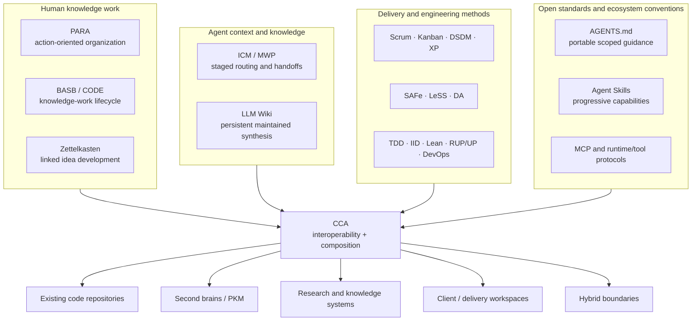
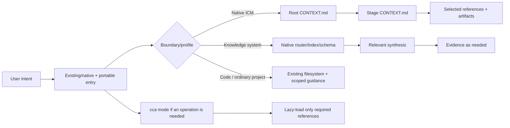

# Convergent Context Architecture

> **CCA (Convergent Context Architecture)** is an evolving, agent-agnostic interoperability layer for filesystem-native AI context. It helps humans and AI agents understand, navigate, and work with the same projects and knowledge by composing existing standards, methods, and conventions without replacing them.

**Automation is the means; augmenting human capabilities is the goal.**

## In plain English

CCA does not ask every project to become a new kind of project.

A code repository can remain a code repository. A PARA second brain can remain PARA. A Zettelkasten can remain a Zettelkasten. A native ICM workspace can remain ICM. Scrum can remain the team's delivery framework, Jira can remain the backlog authority, Git can remain the source/history authority, and an LLM Wiki can remain the maintained-knowledge layer.

CCA adds the smallest missing compatibility and routing layer so humans and agents can understand **what each thing is, who owns it, what context to load, what may be changed, and how the boundaries connect**.

## Core rule

**Convergence over invention.**

CCA must not replace, absorb, supersede, or silently redefine an existing framework, methodology, standard, protocol, or knowledge system merely to make it look uniform. Preserve distinct authorities and connect them through explicit semantics, scopes, mappings, routing, precedence, and compatibility boundaries.

That means doing nothing is a valid CCA result when the existing workspace is already clear, navigable, and durable.

## Why CCA exists

Agent context increasingly lives in ordinary files: repository instructions, task routers, stage contracts, source material, maintained knowledge, skills, configuration, working artifacts, and human-edited outputs. Human knowledge systems and software-delivery methods already solve adjacent parts of the problem, but they operate at different scopes and are interpreted differently across agents and tools.

CCA provides shared ground so an agent can answer, without forcing a migration:

1. **What workspace or boundary am I in?**
2. **What authority already governs it?**
3. **What context do I need for this task?**
4. **What operation should I perform?**
5. **What may I add or change without breaking native semantics?**

The objective is not one universal directory tree. The objective is **interoperability, navigability, portability, and durable human control**.

## What CCA is

CCA is:

- a compatibility and composition architecture for filesystem-native agent context;
- a semantic layer for routing, authority, handoffs, maintained knowledge, and portability;
- one portable Agent Skill with progressively disclosed operational and advisory modes;
- a way to preserve upstream/native behavior while adding cross-agent guidance where useful;
- a framework for deciding when to preserve, harden, compose, validate, or deliberately restructure.

CCA is **not**:

- an agent runtime or orchestration framework;
- a real-time multi-agent message bus;
- a scheduler or queue;
- a vector database or retrieval engine;
- a replacement for MCP;
- a replacement for ICM, LLM Wiki, AGENTS.md, Agent Skills, PARA, BASB/CODE, Zettelkasten, Scrum, Kanban, XP, DevOps, SAFe, LeSS, DA, or other established methods;
- a requirement that every repository use `CONTEXT.md`, stages, a wiki, a manifest, or a fixed directory tree.

## The convergence model

CCA composes several layers that should remain distinct:



The arrows mean **CCA can reason about and connect these authorities**, not that CCA owns or reimplements them.

## One installable skill, seven modes

CCA ships as one self-contained Agent Skill under [`skills/cca/`](skills/cca/).

```text
skills/cca/
├── SKILL.md
├── references/
│   ├── core/          # normative CCA semantics and compatibility
│   ├── architect/     # workspace structure, forms, boundaries
│   ├── advisor/       # engineering/process judgment corpus
│   └── operations/    # scaffold, sync, ingest, query, lint procedures
└── assets/
    └── templates/
```

The root `SKILL.md` is a compact router. It selects one of seven modes and loads only the references that mode needs:

| Mode | Responsibility |
|---|---|
| `architect` | Design/restructure workspaces, choose forms, identify boundaries, and compose methods/profiles. |
| `scaffold` | Add the smallest useful routing/context layer without reorganizing existing content. |
| `sync` | Reconcile routing/navigation with the actual filesystem without inventing semantic state. |
| `ingest` | Integrate evidence into maintained knowledge using the workspace's own schema. |
| `query` | Query/synthesize maintained knowledge and escalate to evidence when verification is required. |
| `lint` | Validate the compatibility/conformance profile actually claimed. |
| `advise` | Apply engineering, process, security, agent-system, context, and AI/ML judgment without converting priors into enforcement. |

This packaging keeps installation atomic while preserving progressive disclosure. A lint request does not need to load architecture or methodology references; an advice request does not need workspace templates.

### Architect and advisor are separate domains

The unified package does **not** mean one undifferentiated reference corpus.

`references/architect/` answers: **How should this workspace/context system be structured?**

`references/advisor/` answers: **What engineering judgment should inform the decision?**

The advisor corpus keeps seven independent references:

1. engineering principles;
2. frameworks and methodologies;
3. security and adversarial thinking;
4. agent-system design;
5. context engineering;
6. AI/ML practice;
7. escalation triggers.

Architect mode may lazily consult one of those references when a structural decision requires it. It must not duplicate, absorb, or redefine advisor guidance.

## Runtime authority

Normative CCA semantics live **inside the installable skill**:

- [`core/spec.md`](skills/cca/references/core/spec.md) — CCA specification;
- [`core/compatibility.md`](skills/cca/references/core/compatibility.md) — upstream/native compatibility boundaries;
- [`core/method-composition.md`](skills/cca/references/core/method-composition.md) — composition semantics;
- [`core/adapters.md`](skills/cca/references/core/adapters.md) — harness adapter rules.

There is deliberately no separate repository-level `spec/` directory. An installed CCA skill must carry the same authority that the repository documentation describes.

## Workspace forms

CCA architecture can use six forms when they solve the actual problem. These are options, not mandatory templates.

| Form | Best fit |
|---|---|
| **Pipeline** | Sequential work with explicit stage inputs, process, outputs, and handoffs. |
| **Umbrella** | Several independent or nested workspaces coordinated by a small outer router. |
| **Record Library** | Repeated records sharing a schema/template and lifecycle/catalog semantics. |
| **Knowledge Bundle** | Durable evidence plus maintained synthesis and navigation. |
| **Context Map** | People, teams, workflows, systems, information movement, ownership, value/pain, and governance relationships. |
| **System Map** | Mutable code/files/vaults where source-backed object/process/effect and change-impact reasoning matters. |

Context Map and System Map are intentionally distinct. See [`forms.md`](skills/cca/references/architect/forms.md) and [`system-map.md`](skills/cca/references/architect/system-map.md).

## How CCA handles common environments

### Existing code repository

**Preserve first.** Inspect the existing instructions, source tree, tests, build/package configuration, architecture documentation, issue/backlog systems, and tool-native guidance.

CCA may add or improve a compact `AGENTS.md` or scoped routing when it materially reduces exploration. It should **not** introduce `stages/`, `wiki/`, `_config/`, PARA folders, or a CCA manifest merely because those structures exist elsewhere.

A valid result is:

> The repository already exposes enough durable context. No structural change is warranted.

### Existing code repository using Scrum

Scrum remains the process authority. The real backlog system remains backlog authority. Git remains source/history authority. CI/CD remains delivery authority.

CCA can route agents to those authorities and explain their relationship. If one bounded activity benefits from an ICM-derived workflow—for example a repeatable security review—that workflow can live inside the delivery process without turning Scrum into a filesystem schema or ICM into project management.

### Second brain / PKM

CCA can compose:

- **PARA** as outer action-oriented organization;
- **BASB/CODE** as a lifecycle lens: Capture → Organize → Distill → Express;
- **Zettelkasten** as addressable linked idea development;
- **LLM Wiki** as maintained synthesis;
- **ordinary code repositories or native ICM workspaces** as nested project boundaries.

CCA records routing, authority, and write boundaries. It does not flatten those methods into a new taxonomy.

### Native ICM

Keep it native ICM. Preserve the complete applicable upstream profile, including its harness-native entry behavior, root/stage routing, exact stage contracts, naming, setup/status/questionnaire behavior, handoffs, selective loading, quality guardrails, and acceptance surface.

Portable `AGENTS.md` guidance may coexist where useful, but CCA must not overwrite an existing native `CLAUDE.md` simply to make the workspace look more portable.

Borrowing ICM stage patterns inside another project is **ICM-derived**, not native ICM compatibility.

### LLM Wiki

Preserve the implementation's own schema and maintenance model. CCA can add optional portability/provenance hardening when it solves a real problem, but does not define one universal LLM Wiki directory tree.

See [Scenarios](docs/scenarios.md) for expected behavior across these cases.

## Compatibility model

CCA separates three states:

| State | Meaning |
|---|---|
| **Native-compatible** | CCA can consume the upstream workspace without structural migration, and generated/materially rewritten native profiles satisfy the applicable upstream acceptance surface. |
| **CCA-hardened** | Optional CCA routing, portability, provenance, or maintenance conventions were added without replacing native semantics. |
| **CCA-conformant** | A workspace intentionally adopts CCA-specific semantics. |

Compatibility is an acceptance guarantee, not ownership. An ICM workspace or LLM Wiki does not become “CCA” merely because CCA can understand it.

## Context routing

CCA does not impose one universal router:



The common rule is: **load the smallest context that lets the agent act correctly.**

## Validation model

Validation follows the profile actually claimed:

- native ICM → full applicable ICM acceptance surface;
- ICM-derived → only the borrowed ICM constructs;
- native LLM Wiki → maintained-knowledge behavior without imposing CCA taxonomy;
- intentional CCA conformance → adopted CCA requirements;
- PARA/Zettelkasten/BASB/Scrum/etc. → preserve their declared/local semantics rather than inventing fake CCA certification profiles.

After profile-specific checks, CCA can apply its portability walk test:

> Can a fresh agent with no chat memory **orient, act, and report** from durable workspace context alone?

This walk test supplements upstream validation; it never replaces it.

## Is CCA better than ICM?

That question needs a scoped answer.

For a **native ICM workspace**, CCA should be **no worse than the current upstream behavior**. If CCA diverges from native ICM while claiming compatibility, that is a defect.

CCA aims to be more capable when the problem crosses boundaries that ICM alone does not own: an existing codebase that should not become a pipeline, a PARA/Zettelkasten second brain, an LLM Wiki, a system/change-impact map, delivery methodologies such as Scrum, multiple nested authorities, or cross-agent portability.

Architecture alone does not prove behavioral superiority. CCA therefore defines an A/B evaluation protocol under [`evals/`](evals/) that compares actual agent runs rather than simulated predicted outputs. Until those runs demonstrate it, the correct claim is:

> **CCA is designed as a broader interoperability and compatibility architecture; behavioral superiority over ICM must be measured per scenario.**

## Getting started

1. Install or expose [`skills/cca/`](skills/cca/) to an Agent Skills-compatible agent.
2. Describe the real workspace/problem rather than requesting a CCA-shaped tree.
3. Let the router choose the smallest mode.
4. Preserve existing authorities first.
5. Validate any native compatibility claim before optional hardening.

Examples:

- “Review this existing repository and add only the context routing it actually needs.” → `scaffold` / possibly `architect`.
- “Can PARA, Zettelkasten and an LLM Wiki coexist here?” → `architect`, with method-composition references.
- “How should Scrum and this ICM security-review workflow interact?” → `architect` + lazy consultation of advisor `frameworks-and-methodologies.md`.
- “Integrate these papers into the maintained knowledge base.” → `ingest`.
- “Validate whether this is truly native ICM.” → `lint`.
- “Which process/engineering trade-off should we choose?” → `advise`.

Read [Getting started](docs/getting-started.md), [FAQ](docs/faq.md), [Scenarios](docs/scenarios.md), and [Method composition](docs/method-composition.md).

## Design principles

1. **Convergence over invention.** Preserve existing authorities before adding CCA semantics.
2. **Plain files as a durable interface.** Humans and agents can inspect the same state.
3. **Route the right context.** Selective loading beats indiscriminate loading.
4. **One fact, one canonical home.** Point rather than duplicate authoritative rules.
5. **Use structure only when it earns its cost.** No mandatory pipeline/wiki/database for cosmetic consistency.
6. **Preserve native semantics before hardening.** Compatibility comes first.
7. **Compose boundaries; do not flatten methods.** Coexistence is not schema merger.
8. **Infer before serializing metadata.** Do not build manifests that merely restate obvious paths.
9. **Human-editable files are valid handoff surfaces.** Human steering remains durable.
10. **Persistent synthesis when knowledge should compound.** Avoid rebuilding durable understanding from scratch.
11. **Stable context plane, replaceable execution plane.** Models/runtimes/providers must not own durable context.
12. **Progressive disclosure.** One skill can expose several focused modes without loading all knowledge at once.
13. **Optional infrastructure stays optional.** Databases, vector stores, MCP, queues, and orchestration can extend CCA without defining it.
14. **Automation is infrastructure; augmentation is the objective.**

See [Design principles](docs/design-principles.md).

## Repository documentation

- [Documentation index](docs/README.md)
- [Getting started](docs/getting-started.md)
- [FAQ](docs/faq.md)
- [Scenarios](docs/scenarios.md)
- [Method composition](docs/method-composition.md)
- [Compatibility details](docs/compatibility-details.md)
- [Standards](docs/standards.md)
- [Migration](docs/migration.md)
- [References](docs/references.md)

Non-normative publication forms are under [`examples/publications/`](examples/publications/): blog, article, and research/whitepaper-style paper.

## Contributing

See [CONTRIBUTING.md](CONTRIBUTING.md).

Compatibility and composition changes should cite the relevant primary source and update the complete affected surface—core semantics, mode references, templates, docs, examples, publications, and regression checks—in the same change.

## Citation

Citation metadata is provided in [CITATION.cff](CITATION.cff).

## License

MIT. See [LICENSE](LICENSE).