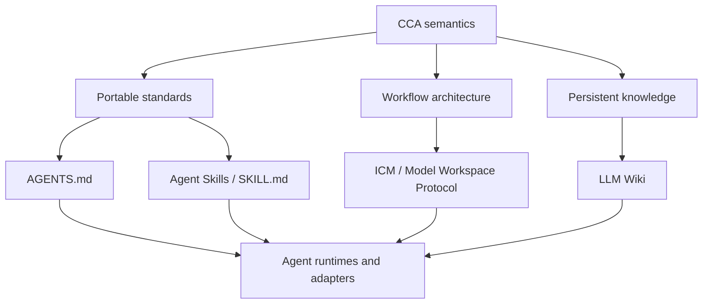
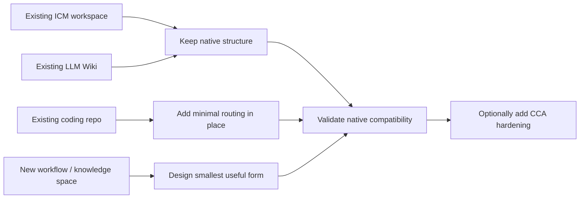
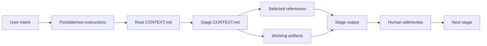

# CCA — Convergent Context Architecture

> **CCA is an interoperability and evolution layer for filesystem-native agent context. It builds on ICM and LLM Wiki, adopts ecosystem conventions such as AGENTS.md and Agent Skills, and prefers convergence over introducing competing conventions.**

CCA does not replace ICM or LLM Wiki. It provides shared semantics, portable operations, and compatibility rules so agents can work across staged ICM workspaces, persistent LLM Wiki-style knowledge bases, ordinary coding repositories, and hybrids without requiring a proprietary runtime.

## The core idea



CCA's rule is simple: **when an upstream convention already solves the problem, preserve it.** CCA may add optional hardening where upstreams intentionally leave implementation open, but it should not fork an upstream shape and still call it identical.

## Compatibility, not replacement

CCA distinguishes three states:

| State | Meaning |
|---|---|
| **Native-compatible** | CCA tooling can consume the upstream workspace without structural migration. |
| **CCA-hardened** | Optional CCA routing, portability, provenance, or maintenance conventions were added. |
| **CCA-conformant** | The workspace intentionally adopts the CCA specification. |

An ICM workspace or LLM Wiki does not become “CCA” merely because CCA can understand it.

### ICM

CCA preserves the ICM conventions it relies on: five-layer routing, native `CLAUDE.md` behavior, root/stage `CONTEXT.md`, exact `Inputs` / `Process` / `Outputs` stage contracts, selective section loading, one-way references, canonical sources, zero-padded hyphenated stage names such as `01-collect`, and human-editable `output/` handoffs.

Portable `AGENTS.md` guidance may be added where useful, but CCA must not break the native ICM entry path to do so.

### LLM Wiki

CCA preserves LLM Wiki as an intentionally flexible idea pattern: durable source material plus maintained LLM-owned synthesis that compounds across sessions. CCA can recommend an opinionated implementation, but it does not treat its own directory taxonomy, YAML frontmatter, log syntax, or page types as universal LLM Wiki requirements.

## Start here



Read [`docs/getting-started.md`](docs/getting-started.md) for the practical path from each starting point. Common questions — Obsidian, VS Code, coding projects, MCP, databases, nested `AGENTS.md`, multi-agent work, and what CCA is not — are in [`docs/faq.md`](docs/faq.md).

## Agent routing

For an ICM-compatible pipeline, routing remains layered and selective:



A knowledge workspace may use a different router/index/schema. CCA does not force every workspace into pipeline layers.

## Portable operations

The repository ships six Agent Skills packages:

| Skill | Purpose |
|---|---|
| [`cca-architect`](skills/cca-architect/) | Design or restructure a workspace while preserving native compatibility. |
| [`cca-scaffold`](skills/cca-scaffold/) | Add the smallest useful routing/context layer without restructuring existing content. |
| [`cca-sync`](skills/cca-sync/) | Reconcile routing/navigation with disk while preserving scope and native semantics. |
| [`cca-ingest`](skills/cca-ingest/) | Integrate new evidence into maintained knowledge using the workspace's own schema. |
| [`cca-query`](skills/cca-query/) | Query maintained synthesis and verify against source evidence as needed. |
| [`cca-lint`](skills/cca-lint/) | Validate the correct profile and separate compatibility failures from optional hardening. |

Each skill is designed to remain useful when copied independently: core execution must not require a sibling skill or repository-global file.

## Repository layout

The repository itself is intentionally small and mirrors the separation used by ICM: canonical specification, explanatory documentation, portable skills, templates, and worked workspaces.

```text
CCA/
├── AGENTS.md
├── CLAUDE.md
├── README.md
├── CONTRIBUTING.md
├── spec/
│   ├── SPEC.md
│   ├── compatibility.md
│   └── adapters.md
├── docs/
│   ├── getting-started.md
│   ├── faq.md
│   ├── migration.md
│   ├── principles.md
│   └── standards.md
├── skills/
│   ├── cca-architect/
│   ├── cca-scaffold/
│   ├── cca-sync/
│   ├── cca-ingest/
│   ├── cca-query/
│   └── cca-lint/
├── examples/
│   └── topic-research/
└── scripts/
    └── validate_repo.py
```

## Design principles

1. **Convergence over invention.** Adopt standards and upstream shapes rather than minting competing ones.
2. **Plain files as the durable interface.** Humans and agents can inspect and edit the same state.
3. **Route the right context.** Selective context beats indiscriminate loading.
4. **One fact, one canonical home.** Link instead of duplicating authoritative rules.
5. **One stage, one job.** Preserve explicit contracts and one-way dependencies for pipelines.
6. **Every output is an edit surface.** File handoffs keep human review visible and durable.
7. **Persistent synthesis over stateless retrieval.** When knowledge should compound, maintain it instead of rebuilding it per query.
8. **Optional infrastructure stays optional.** Databases, vector stores, MCP, and orchestration may extend CCA but are not required to understand the workspace.

See [`docs/principles.md`](docs/principles.md) for the extended rationale.

## What CCA is not

CCA is not an agent runtime, orchestration framework, message bus, vector database, replacement for MCP, replacement for ICM, or replacement for LLM Wiki.

Real-time multi-agent collaboration, where agents need to communicate dynamically in tight loops, requires message-passing/orchestration infrastructure. CCA can provide durable shared context beneath such systems.

## Staying compatible as upstreams evolve

[`docs/standards.md`](docs/standards.md) is the tracked upstream compatibility surface. When an upstream changes, CCA should verify the primary source and update the spec, affected skills/templates, examples, migration guidance, and compatibility matrix together rather than freezing a stale fork.

## References

- **[ICM / Model Workspace Protocol](https://github.com/RinDig/Interpretable-Context-Methodology)** — Jake Van Clief & David McDermott, [Interpretable Context Methodology: Folder Structure as Agent Architecture](https://arxiv.org/pdf/2603.16021)
- **[LLM Wiki](https://gist.github.com/karpathy/442a6bf555914893e9891c11519de94f)** — Andrej Karpathy's idea pattern for LLM-maintained persistent knowledge bases
- **[AGENTS.md](https://agents.md)** — portable agent instructions
- **[Agent Skills](https://agentskills.io)** — portable `SKILL.md` packages

## Contributing

See [`CONTRIBUTING.md`](CONTRIBUTING.md). Compatibility changes should cite the relevant primary upstream and update the full affected surface in one change.

## License

MIT. See [`LICENSE`](LICENSE).
