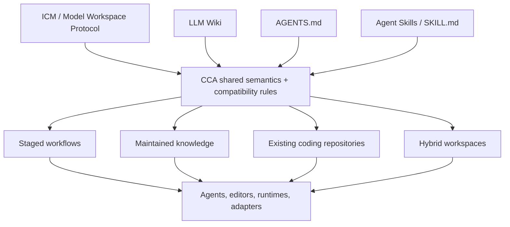
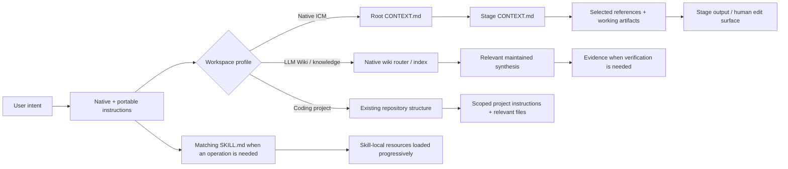
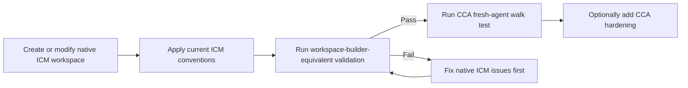
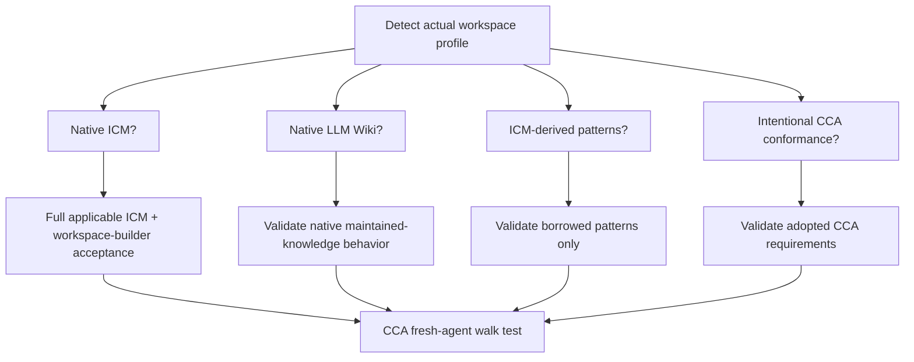

# Convergent Context Architecture

> **CCA is an agent-agnostic interoperability layer for filesystem-native AI context. It makes ICM workspaces, LLM Wikis, AGENTS.md, Agent Skills, and existing projects easier to use together without forcing them into a new competing convention.**

CCA provides shared semantics, portable operations, and compatibility rules so durable context can remain understandable across agents, tools, editors, and runtimes.

It is not a replacement for ICM, LLM Wiki, AGENTS.md, Agent Skills, MCP, or an agent runtime. Its core rule is: **when an upstream convention already solves the problem, preserve it.**

---

## Why CCA exists

Agent context is increasingly stored in ordinary repositories: instructions, task routers, stage contracts, source material, maintained knowledge, skills, configuration, and working artifacts. The problem is that these pieces often come from different ecosystems and are interpreted differently by different agents.

ICM provides a strong filesystem architecture for staged, human-reviewable workflows. LLM Wiki provides a pattern for persistent knowledge that compounds across sessions. AGENTS.md provides portable repository instructions. Agent Skills provide portable capabilities. Existing coding repositories already have their own structure and conventions.

CCA defines the shared ground between them so an agent can answer four questions without forcing a migration:

1. **What kind of workspace is this?**
2. **Which upstream conventions already govern it?**
3. **What context should I load for this task?**
4. **What can I add without breaking native compatibility?**

The objective is not to make every workspace look the same. The objective is to make different valid workspace forms **interoperable, navigable, and portable**.

## The convergence model

CCA sits downstream of the conventions it adopts. It does not own or redefine them.



If an upstream changes, CCA should change toward it rather than freezing a near-compatible fork.

## What CCA is, and what is not

CCA **is**:

- a compatibility layer for filesystem-native agent context;
- a set of shared semantics for routing, durable knowledge, handoffs, and portability;
- a set of portable Agent Skills for designing, scaffolding, maintaining, querying, and validating workspaces;
- a way to add cross-agent guidance without destroying native tool behavior;
- a framework for deciding when to preserve, harden, or intentionally conform a workspace.

CCA **is not**:

- an agent runtime or orchestration framework;
- a real-time multi-agent message bus;
- a scheduler or queue;
- a vector database or retrieval engine;
- a replacement for MCP;
- a replacement for ICM or LLM Wiki;
- a requirement that every repository use stages, a wiki, `CONTEXT.md`, or one fixed directory tree.

## Compatibility model

CCA deliberately separates three states:

| State | Meaning |
|---|---|
| **Native-compatible** | CCA can consume the upstream workspace without structural migration, and any generated/materially rewritten native profile satisfies that upstream's applicable acceptance surface. |
| **CCA-hardened** | Optional CCA routing, portability, provenance, or maintenance conventions were added without replacing the native profile. |
| **CCA-conformant** | The workspace intentionally adopts the CCA specification. |

An ICM workspace or LLM Wiki does not become “CCA” merely because CCA can understand it.

CCA also distinguishes **native ICM** from **ICM-derived**. A coding repository may borrow numbered stages, stage contracts, or output handoffs because those patterns are useful. That does not make the whole repository a native ICM workspace unless the full applicable ICM profile also passes.

## How context routing works

CCA does not impose one universal router. It preserves the native entry point of the active workspace and adds portable guidance only where useful.



The routing principle is the same across forms: **load the smallest context that lets the agent act correctly.**

## ICM compatibility

CCA accepts a valid ICM workspace without requiring it to migrate into a CCA directory structure.

For native ICM, CCA preserves the ICM concepts it depends on: the five-layer routing architecture, native `CLAUDE.md`, root/stage `CONTEXT.md`, exact stage contracts, selective section loading, one-way dependencies, canonical sources, numbered stage folders, human-editable `output/` handoffs, onboarding, quality gates, and other applicable upstream patterns.

### Does CCA conflict with ICM's workspace-builder?

It should not.

The ICM workspace-builder is itself an ICM workspace whose output is a new validated ICM workspace. CCA treats upstream ICM `_core/CONVENTIONS.md` as the canonical semantic authority and the workspace-builder's final validation stage as the practical acceptance checklist for generated ICM workspaces.

CCA can provide a different architecture/scaffolding interaction, but if the result claims **native ICM compatibility**, it should pass the same applicable upstream acceptance surface. CCA's fresh-agent walk test is an additional portability check, not a replacement for ICM validation.



If CCA documentation and current upstream ICM ever disagree, upstream ICM wins and CCA should be updated.

## LLM Wiki compatibility

CCA preserves LLM Wiki as an intentionally flexible idea pattern: durable source material plus maintained LLM-owned synthesis that compounds across sessions.

CCA may recommend stronger organization when useful, for example: an index, provenance metadata, lifecycle fields, contradiction tracking, or a `raw/` + `wiki/` split, but these are **CCA hardening choices**, not universal requirements of LLM Wiki.

A pre-existing LLM Wiki should be understood through its own schema and maintenance instructions before CCA adds anything.

## Choose the smallest workspace form

CCA starts from the work, not from a preferred tree.

| Need | Good starting form |
|---|---|
| Repeatable sequential workflow with explicit human handoffs | **Full native ICM pipeline** if you want complete ICM semantics, or **ICM-derived stages** if you only need the stage-contract pattern inside another project |
| Knowledge that should compound across sessions | **LLM Wiki-style maintained knowledge** |
| Existing software repository | **Keep the existing repository**, add only useful portable/scoped routing |
| Pipeline that consumes or updates persistent knowledge | **Hybrid** |
| Real-time agent-to-agent coordination | Use an orchestration/message-passing system; CCA may provide the durable shared context beneath it |

## Getting started

You do not need to install a CCA runtime. Use the repository/files with an agent that can read them, or copy/install the relevant skill package into a compatible Agent Skills location for your environment.

### I already have an ICM workspace

Keep it as ICM. Do not rename stages, replace `CLAUDE.md`, rewrite contracts, or move references merely to satisfy CCA.

Use `cca-lint` in **ICM native compatibility** mode. Add CCA hardening only after native validation passes.

### I already have an LLM Wiki

Keep its schema and maintenance model. Use `cca-lint` in **LLM Wiki native compatibility** mode. Add optional CCA routing/provenance conventions only when they solve a real problem.

### I already have a coding project

Use `cca-scaffold` in its default quick mode. A useful change may be only a root `AGENTS.md` plus scoped instructions for subtrees. `CONTEXT.md`, stages, a wiki, `_config/`, or other structures are optional.

Do not reorganize application code around CCA unless the user explicitly wants restructuring.

### I want to build a new workspace

Use `cca-architect`. Describe the real workflow/knowledge problem first; let the form follow from it.

If you want a complete ICM workspace, request the **full native ICM profile**. If you only want sequential stage contracts inside another repository, request **ICM-derived stages** instead.

Read [`docs/getting-started.md`](docs/getting-started.md) for the detailed paths and [`docs/faq.md`](docs/faq.md) for common questions about Obsidian, VS Code, coding projects, MCP, databases, nested `AGENTS.md`, multi-agent work, and more.

## A native ICM stage contract

When the ICM profile is active, CCA preserves the upstream contract shape instead of inventing a near-equivalent variant:

```markdown
## Inputs

| Source | File/Location | Section/Scope | Why |
|---|---|---|---|
| Previous stage | `../01-research/output/` | Full file | Source material |
| Style guide | `../../references/voice.md` | "Voice Rules" | Tone guidance |

## Process

1. Read the routed inputs.
2. Perform the stage's single job.
3. Run applicable checkpoints/audits.
4. Write the declared output.

## Outputs

| Artifact | Location | Format |
|---|---|---|
| Brief | `output/example-brief.md` | Markdown |
```

The full native ICM profile includes more than this contract; see [`docs/standards.md`](docs/standards.md) and the upstream ICM conventions before claiming complete compatibility.

## Why plain files matter

### Portability

A filesystem-native workspace can be copied, versioned, inspected, edited, or handed to another compatible agent without requiring a proprietary state store. CCA treats databases, vector indexes, MCP servers, and orchestration as optional infrastructure around the durable workspace rather than prerequisites for understanding it.

### Observability

Instructions, references, intermediate artifacts, and maintained knowledge remain visible as files. When a result is wrong, a human can inspect the exact router, contract, reference, or prior artifact involved instead of relying on an opaque runtime state.

### Human augmentation

Automation is infrastructure; augmentation is the objective. Durable edit surfaces let agents handle repetitive context/navigation work while humans retain the ability to inspect, steer, revise, and veto the state that subsequent operations consume.

## Where CCA works well

CCA is a strong fit when the work benefits from:

- persistent context across sessions;
- portability across agents/editors/runtimes;
- selective context loading;
- human-readable and versionable state;
- repeatable stage handoffs;
- maintained knowledge that compounds;
- scoped instructions in an existing codebase;
- optional infrastructure rather than a mandatory platform.

## Where CCA is not enough

CCA deliberately does not solve every systems problem.

**Real-time multi-agent collaboration**: agents communicating dynamically in tight loops, needs message-passing/orchestration infrastructure.

**High-concurrency shared services**: need queueing, isolation, locking/transactions, deployment, and other runtime concerns.

**Complex automated branching or scheduling** may need a workflow engine. CCA can still store the durable context and contracts that such a runtime consumes.

**Large-scale retrieval** may benefit from databases, embeddings, indexes, or graph systems. Those are compatible extensions as long as the durable workspace remains understandable without treating the external index as the only source of truth.

## Portable operations

CCA ships six standalone Agent Skills packages:

| Skill | Purpose |
|---|---|
| [`cca-architect`](skills/cca-architect/) | Design or restructure a workspace while preserving native compatibility. |
| [`cca-scaffold`](skills/cca-scaffold/) | Add the smallest useful routing/context layer without restructuring existing content. |
| [`cca-sync`](skills/cca-sync/) | Reconcile routing/navigation with disk while preserving scope and native semantics. |
| [`cca-ingest`](skills/cca-ingest/) | Integrate new evidence into maintained knowledge using the workspace's own schema. |
| [`cca-query`](skills/cca-query/) | Query maintained synthesis and verify against source evidence as needed. |
| [`cca-lint`](skills/cca-lint/) | Validate the correct native/conformance profile and separate failures from optional hardening. |

Each skill is designed to remain useful when copied independently: core execution must not require a sibling skill or repository-global file.

## Validation model

Validation follows the active profile instead of imposing the strictest known schema on everything.



The walk test asks whether a fresh agent with no chat memory can **orient, act, and report** from the durable workspace. It is useful across profiles, but it never overrides stricter upstream acceptance criteria.

## Repository layout

The CCA repository separates normative specification, explanatory guidance, portable skills, examples, and validation tooling:

```text
CCA/
├── AGENTS.md
├── CLAUDE.md
├── README.md
├── CONTRIBUTING.md
├── CITATION.cff
├── spec/
│   ├── SPEC.md
│   ├── compatibility.md
│   └── adapters.md
├── docs/
│   ├── getting-started.md
│   ├── faq.md
│   ├── migration.md
│   ├── principles.md
│   └── standards.md
├── skills/
│   ├── cca-architect/
│   ├── cca-scaffold/
│   ├── cca-sync/
│   ├── cca-ingest/
│   ├── cca-query/
│   └── cca-lint/
├── examples/
│   └── topic-research/
└── scripts/
    └── validate_repo.py
```

## Design principles

1. **Convergence over invention.** Adopt current standards/upstream shapes rather than minting competing ones.
2. **Plain files as the durable interface.** Humans and agents can inspect the same state.
3. **Route the right context.** Selective loading beats indiscriminate loading.
4. **One fact, one canonical home.** Link instead of duplicating authoritative rules.
5. **Use structure only when it earns its cost.** No mandatory pipeline/wiki/database for cosmetic consistency.
6. **Preserve native semantics before hardening.** Compatibility comes before optional CCA improvements.
7. **Every durable output can be an edit surface.** Human changes remain visible to subsequent operations.
8. **Persistent synthesis when knowledge should compound.** Do not repeatedly rebuild durable understanding when maintaining it is more useful.
9. **Optional infrastructure stays optional.** Databases, vector stores, MCP, and orchestration extend the system; they do not define CCA.
10. **Automation is infrastructure; augmentation is the objective.** The workspace should increase human leverage without making its state opaque.

See [`docs/principles.md`](docs/principles.md) for the extended rationale.

## Staying compatible as upstreams evolve

[`docs/standards.md`](docs/standards.md) tracks the upstream surfaces that materially constrain CCA. When one changes, CCA should verify the primary source and update the spec, affected skills/templates, examples, compatibility guidance, and validation together.

That maintenance rule is part of the architecture: **compatibility is not a one-time claim.**

## FAQ

The full FAQ is in [`docs/faq.md`](docs/faq.md), including:

- Can I use CCA with Obsidian?
- Can I use it in VS Code or another editor?
- What if I already have a coding project?
- Does every workspace need `CONTEXT.md`, stages, or a wiki?
- How do `AGENTS.md` and `CLAUDE.md` coexist?
- Can CCA work with Claude Code, Codex, Cursor, Gemini, Copilot, and other agents?
- Does CCA require MCP, Git, a database, or a vector store?
- How does CCA fit into multi-agent systems?

## References

- **[ICM / Model Workspace Protocol](https://github.com/RinDig/Interpretable-Context-Methodology)**: Jake Van Clief & David McDermott \
    [Interpretable Context Methodology: Folder Structure as Agent Architecture Paper](https://arxiv.org/pdf/2603.16021)
- **[LLM Wiki](https://gist.github.com/karpathy/442a6bf555914893e9891c11519de94f)**: Andrej Karpathy's idea pattern for LLM-maintained persistent knowledge bases
- **[AGENTS.md](https://agents.md)**: portable agent instructions
- **[Agent Skills](https://agentskills.io)**: portable `SKILL.md` packages

## Contributing

See [`CONTRIBUTING.md`](CONTRIBUTING.md). Compatibility changes should cite the relevant primary upstream and update the full affected surface in one change.

Run the repository validator before submitting changes:

```bash
python scripts/validate_repo.py
```

## Citation

Citation metadata is provided in [`CITATION.cff`](CITATION.cff).

## License

MIT. See [`LICENSE`](LICENSE).
