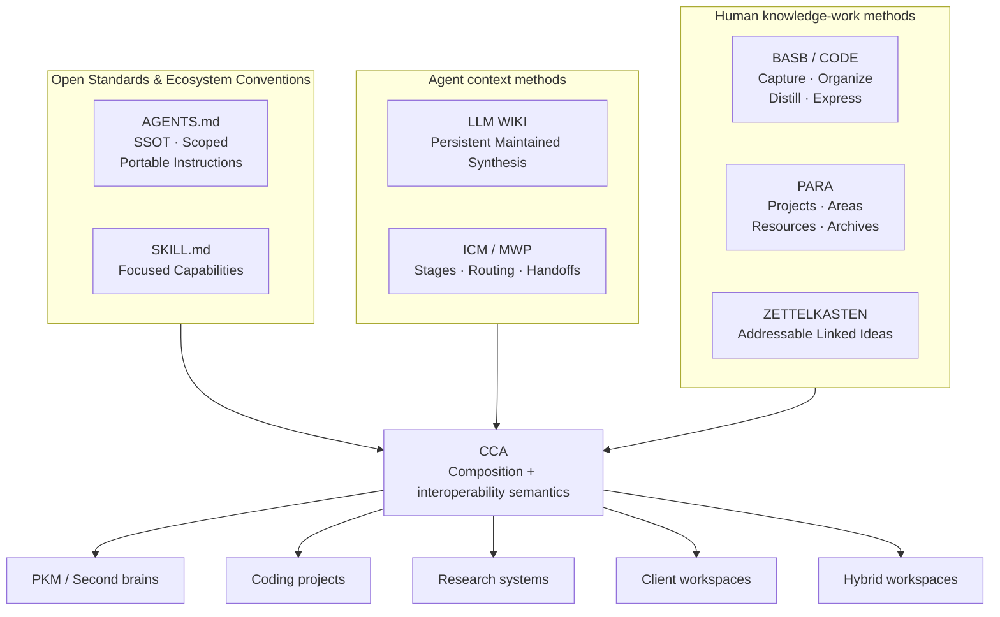
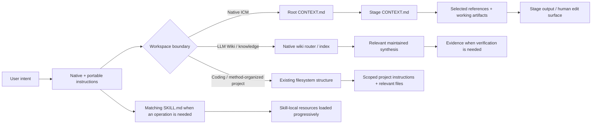
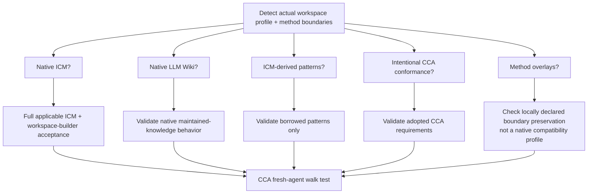
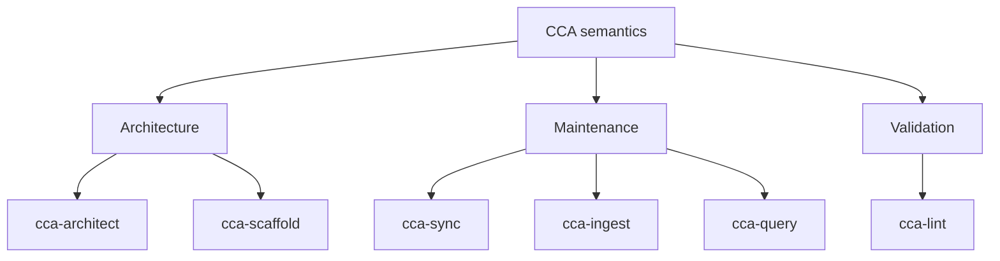

# Convergent Context Architecture

> **CCA is an evolving, agent-agnostic interoperability layer for filesystem-native AI context proposed to bridge the gap between human knowledge work, agentic work, and , by following open standards, ecosystem conventions and proving working methodologies and protocols to make any workspace, project, or body of human knowledge, easier to use without forcing it into a new competing convention with the goal to make automation easier in service of augmenting human capabilities while reducing operational infrastructure costs.**

## Why CCA exists

Agent context is increasingly stored in ordinary repositories: instructions, task routers, stage contracts, source material, maintained knowledge, skills, configuration, vendor semantics, and working artifacts. Human knowledge systems already provide useful ways to organize, develop, and maintain that material. The problem is not that these systems need a single universal replacement; it is that their boundaries and semantics are interpreted differently by different agents.

ICM provides a filesystem architecture for staged, human-reviewable workflows. LLM Wiki provides a pattern for persistent knowledge that compounds across sessions. AGENTS.md provides portable repository instructions. Agent Skills provide focused portable capabilities. PARA, Zettelkasten, and Building a Second Brain address human organization, idea development, and knowledge-work lifecycle. Existing coding repositories already have their own structure and conventions.

CCA brings these ideas together through shared semantics, focused portable operations, compatibility rules, and existing open standards. It bridges human knowledge work and agentic work without replacing the systems that already work, making durable context easier to understand, reuse, and operate across different environments while keeping those patterns accessible to anyone.

Therefore, defining the shared ground between them, so an agent can answer five questions without forcing a migration:

1. **What type of workspace or boundary is this?**
2. **What context should I load for this task?**
3. **What capability should the operation perform?**
4. **What source conventions or methods already govern it?**
5. **What can I add without altering the native semantics?**

The objective is not to make every workspace look the same. The objective is to make different valid workspace forms **interoperable, navigable, and portable**.

## The Convergence Model

CCA composes several different layers. They are not all the same kind of standard.



If an upstream changes, CCA should change toward it rather than freezing a near-compatible fork. Human methodologies remain method overlays unless CCA deliberately adopts a concrete machine-facing contract from them in a future revision.

## What CCA is, and what is not

CCA **IS**:

- a compatibility and composition layer for filesystem-native agent context;
- a set of shared semantics for routing, durable knowledge, handoffs, authority boundaries, and portability;
- a focused Agent Skills suite for designing, scaffolding, maintaining, querying, and validating workspaces;
- a way to add cross-agent guidance without destroying native tool behavior;
- a framework for deciding when to preserve, harden, intentionally conform, or simply compose existing methods.

CCA **IS NOT**:

- an agent runtime or orchestration framework;
- a real-time multi-agent message bus;
- a scheduler or queue;
- a vector database or retrieval engine;
- a replacement for MCP;
- a replacement for ICM, LLM Wiki, PARA, BASB, or Zettelkasten;
- a requirement that every repository use stages, a wiki, vendor semantics, a giant manifest, or one fixed directory tree.

> [!IMPORTANT]
> CCA core rule is: **when an upstream convention, open standard, or existing method already solves the problem, preserve it.**

## Compatibility model

CCA deliberately separates three states:

| State | Meaning |
| --- | --- |
| **Native-compatible** | CCA can consume the upstream workspace without structural migration, and any generated/materially rewritten native profile satisfies that upstream's applicable acceptance surface. |
| **CCA-hardened** | Optional CCA routing, portability, provenance, or maintenance conventions were added without replacing the native profile. |
| **CCA-conformant** | The workspace intentionally adopts the CCA specification. |

An ICM workspace or LLM Wiki does not become “CCA” merely because CCA can understand it.

CCA also distinguishes **native ICM** from **ICM-derived**. A coding repository may borrow numbered stages, stage contracts, or output handoffs because those patterns are useful. That does not make the whole repository a native ICM workspace unless the full applicable ICM profile also passes.

Method overlays such as PARA, Zettelkasten, and BASB do not create additional native compatibility states. They are preserved and composed at their boundaries.

### How context routing works

CCA does not impose one universal router. It preserves the native entry point of the active workspace and adds portable guidance only where useful.



The routing principle is the same across forms: **load the smallest context that lets the agent act correctly.**

CCA should infer ordinary filesystem semantics when it can do so safely. It does not need a central YAML manifest merely to restate obvious paths such as Projects, Areas, Resources, Archives, stages, wiki folders, or skill collections.

See [Compatibility Details](docs/compatibility-details.md) for a complete list of how all diferent methodologies and frameworks connect.

## A native ICM stage contract

When the ICM profile is active, CCA preserves the upstream contract shape instead of inventing a near-equivalent variant:

```markdown
## Inputs

| Source         | File/Location               | Section/Scope | Why             |
| -------------- | --------------------------- | ------------- | --------------- |
| Previous stage | `../01-research/output/`    | Full file     | Source material |
| Style guide    | `../../references/voice.md` | "Voice Rules" | Tone guidance   |

## Process

1. Read the routed inputs.
2. Perform the stage's single job.
3. Run applicable checkpoints/audits.
4. Write the declared output.

## Outputs

| Artifact | Location                  | Format   |
| -------- | ------------------------- | -------- |
| Brief    | `output/example-brief.md` | Markdown |
```

The full native ICM profile includes more than this contract; see [`docs/standards.md`](docs/standards.md) and the upstream ICM conventions before claiming complete compatibility.

## Why plain files matter

### Portability

A filesystem-native workspace can be copied, versioned, inspected, edited, or handed to another compatible agent without requiring a proprietary state store. CCA treats databases, vector indexes, MCP servers, and orchestration as optional infrastructure around the durable workspace rather than prerequisites for understanding it.

For Agent Skills, portability means implementation file references remain inside the skill package and installation layout is not part of the capability contract. It does **not** mean every CCA skill must be an unrelated standalone product.

### Observability

Instructions, references, intermediate artifacts, and maintained knowledge remain visible as files. When a result is wrong, a human can inspect the exact router, contract, reference, or prior artifact involved instead of relying on an opaque runtime state.

### Human augmentation

Automation is infrastructure; augmentation is the objective. Durable edit surfaces let agents handle repetitive context/navigation work while humans retain the ability to inspect, steer, revise, and veto the state that subsequent operations consume.

## Where CCA works well

CCA is a strong fit when the work benefits from:

- persistent context across sessions;
- portability across agents/editors/runtimes;
- selective context loading;
- human-readable and versionable state;
- repeatable stage handoffs;
- maintained knowledge that compounds;
- PKM/second-brain methods connected to agent workflows without being replaced;
- scoped instructions in an existing codebase;
- optional infrastructure rather than a mandatory platform.

## Where CCA is not enough

As CCA core comes from the ICM/MWP PDLC framework, it still inherits their gaps and deliberately does not solve every systems problem.

1. **Real-time multi-agent collaboration**
    agents communicating dynamically in tight loops need message-passing/orchestration infrastructure.
2. **High-concurrency shared services**
    need queueing, isolation, locking/transactions, deployment, and other runtime concerns.
3. **Complex automated branching or scheduling**
    may need a workflow engine. CCA can still store the durable context and contracts that such a runtime consumes.
4. **Large-scale retrieval**
    may benefit from databases, embeddings, indexes, or graph systems. Those are compatible extensions as long as the durable workspace remains understandable without treating the external index as the only source of truth.

## Validation model

Validation follows the active profile instead of imposing the strictest known schema on everything.



The walk test asks whether a fresh agent with no chat memory can **orient, act, and report** from the durable workspace. It is useful across profiles, but it never overrides stricter upstream acceptance criteria.

## CCA skill suite

CCA ships six focused Agent Skills as one capability suite, following software engineering fundamentals and the key design principles of Agent Skills open standard:

| Skill | Purpose |
| --- | --- |
| [`cca-architect`](skills/cca-architect/) | Design/restructure compound workspaces, choose forms, preserve boundaries, and coordinate focused CCA operations. |
| [`cca-scaffold`](skills/cca-scaffold/) | Add the smallest useful routing/context layer without restructuring existing content. |
| [`cca-sync`](skills/cca-sync/) | Reconcile routing/navigation with disk while preserving scope and native semantics. |
| [`cca-ingest`](skills/cca-ingest/) | Integrate new evidence into maintained knowledge using the workspace's own schema. |
| [`cca-query`](skills/cca-query/) | Query maintained synthesis and verify against source evidence as needed. |
| [`cca-lint`](skills/cca-lint/) | Validate the correct native/conformance profile and separate failures, method-preservation findings, and optional hardening. |

The split exists for precise triggering and progressive disclosure. `cca-architect` is the primary entry point for **compound architecture** questions, not a mandatory router for every request. A direct lint request should activate `cca-lint`; a direct ingest request should activate `cca-ingest`.

Cross-skill coordination uses semantic capability names such as `Use cca-lint to validate the selected profile`. A skill must not reach into a sibling skill directory or repository-global implementation file by relative path.

> These skills are not mandatory, neither they are a requirement, they were created only to make the process more efficient and simple.

<div align="center">
    <i>Simple mental model vizualisation</i>
</div>



> See the detailed visualization in [method composition](docs/method-composition.md)

## Getting started

You do not need to install a CCA runtime. Use the repository/files with an agent that can read them. When using the first-party CCA Agent Skills, install/distribute the **CCA skill suite** so focused capabilities can be discovered progressively.

### I already have an ICM workspace

Keep it as ICM. Do not rename stages, replace `CLAUDE.md`, rewrite contracts, or move references merely to satisfy CCA.

Use `cca-lint` in **ICM native compatibility** mode. Add CCA hardening only after native validation passes.

### I already have an LLM Wiki

Keep its schema and maintenance model. Use `cca-lint` in **LLM Wiki native compatibility** mode. Add optional CCA routing/provenance conventions only when they solve a real problem.

### I already use PARA, Zettelkasten, BASB, or another second-brain method

Keep it. Use `cca-architect` when you want to connect/restructure several methods or introduce nested workflow/knowledge boundaries. CCA should preserve the existing method and add only the routing needed for agents to understand it.

### I already have a coding project

Use `cca-scaffold` in its default quick mode. A useful change may be only a root `AGENTS.md` plus scoped instructions for subtrees. `CONTEXT.md`, stages, a wiki, `_config/`, or other structures are optional.

Do not reorganize application code around CCA unless the user explicitly wants restructuring.

### I want to build a new workspace

Use `cca-architect`. Describe the real workflow/knowledge problem first; let the form follow from it.

If you want a complete ICM workspace, request the **full native ICM profile**. If you only want sequential stage contracts inside another repository, request **ICM-derived stages** instead.

Read [`docs/getting-started.md`](docs/getting-started.md) for detailed paths, [`docs/method-composition.md`](docs/method-composition.md) for method composition, and [`docs/faq.md`](docs/faq.md) for common questions about Obsidian, VS Code, coding projects, second brains, MCP, databases, nested `AGENTS.md`, multi-agent work, and more.

## Repository layout

The CCA repository separates normative specification, explanatory guidance, focused skills, examples, and validation tooling:

```text
CCA/
├── AGENTS.md
├── README.md
├── CONTRIBUTING.md
├── CITATION.cff
├── spec/
│   ├── SPEC.md
│   ├── compatibility.md
│   ├── method-composition.md
│   └── adapters.md
├── docs/
│   ├── getting-started.md
│   ├── faq.md
│   ├── method-composition.md
│   ├── migration.md
│   ├── principles.md
│   └── standards.md
├── skills/
│   ├── cca-architect/
│   ├── cca-scaffold/
│   ├── cca-sync/
│   ├── cca-ingest/
│   ├── cca-query/
│   └── cca-lint/
├── examples/
│   ├── workspaces/
│   │   └── topic-research/
│   ├── articles/
│   └── conversations/
└── .github/
    └── scripts/
        └── validate_repo.py
```

## Design principles

1. **Convergence over invention.** \
    Adopt current standards/upstream shapes rather than minting competing ones.
2. **Plain files as the durable interface.** \
    Humans and agents can inspect the same state.
3. **Route the right context.** \
    Selective loading beats indiscriminate loading.
4. **One fact, one canonical home.** \
    Link instead of duplicating authoritative rules.
5. **Use structure only when it earns its cost.** \
    No mandatory pipeline/wiki/database for cosmetic consistency.
6. **Preserve native semantics before hardening.** \
    Compatibility comes before optional CCA improvements.
7. **Compose boundaries; do not flatten methods.** \
    Outer organization must not silently rewrite nested native semantics.
8. **Infer structure before declaring metadata.** \
    Do not mirror obvious filesystem paths into a central manifest without a real need.
9. **Every durable output can be an edit surface.** \
    Human changes remain visible to subsequent operations.
10. **Persistent synthesis when knowledge should compound.** \
    Do not repeatedly rebuild durable understanding when maintaining it is more useful.
11. **Stable context plane, replaceable execution plane.** \
    Models, runtimes, and providers may change without owning durable context.
12. **One runtime, many context-defined specializations.** \
    Focused skills and routed context specialize a general agent progressively.
13. **Optional infrastructure stays optional.** \
    Databases, vector stores, MCP, collaboration, and orchestration extend the system; they do not define CCA.
14. **Automation is infrastructure; augmentation is the objective.** \
    The workspace should increase human leverage without making its state opaque.

See [PRINCIPLES](docs/principles.md) for the extended rationale.

## Staying compatible as upstreams evolve

The standards tracks the upstream surfaces that materially constrain CCA and separates them from adjacent methodologies/influences. When an upstream changes, CCA should verify the primary source and update the spec, affected skills/templates, examples, compatibility guidance, and validation together.

That maintenance rule is part of the architecture: **compatibility is not a one-time claim.**

See [STANDARDS](docs/standards.md) for the detailed description.

## FAQ

See [FAQ](docs/faq.md) for a detailed list of common questions, doubts and concerns, including:

- How do BASB, PARA, Zettelkasten, LLM Wiki, and ICM fit together?
- Can all of them coexist in one workspace?
- Does a second brain need ICM?
- Why are the six CCA skills a suite rather than one giant skill?
- Can I use CCA with Obsidian?
- Can I use it in VS Code or another editor?
- What if I already have a coding project?
- Does every workspace need `CONTEXT.md`, stages, or a wiki?
- How do `AGENTS.md` and `CLAUDE.md` coexist?
- Can CCA work with Claude Code, Codex, Cursor, Gemini, Copilot, and other agents?
- Does CCA require MCP, Git, a database, or a vector store?
- How does CCA fit into multi-agent systems?

## References

See [REFERENCES](docs/references.md) for the complete list of all referenced sources.

## Contributing

See [CONTRIBUTING](CONTRIBUTING.md).

> Compatibility and composition changes should cite the relevant primary upstream/method source and update the full affected surface in one change.

## Citation

Citation metadata is provided in [CITATION](CITATION.cff).

## License

MIT. See [LICENSE](LICENSE).
