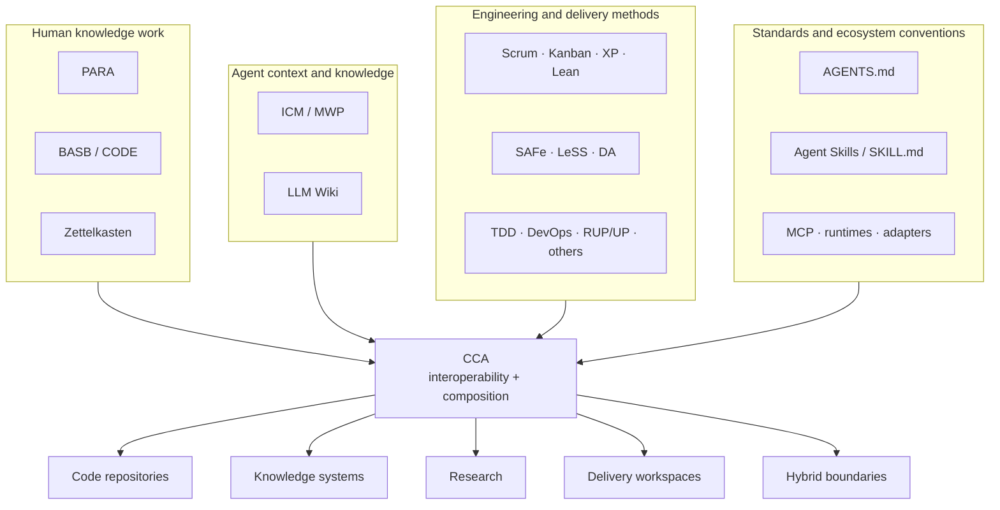
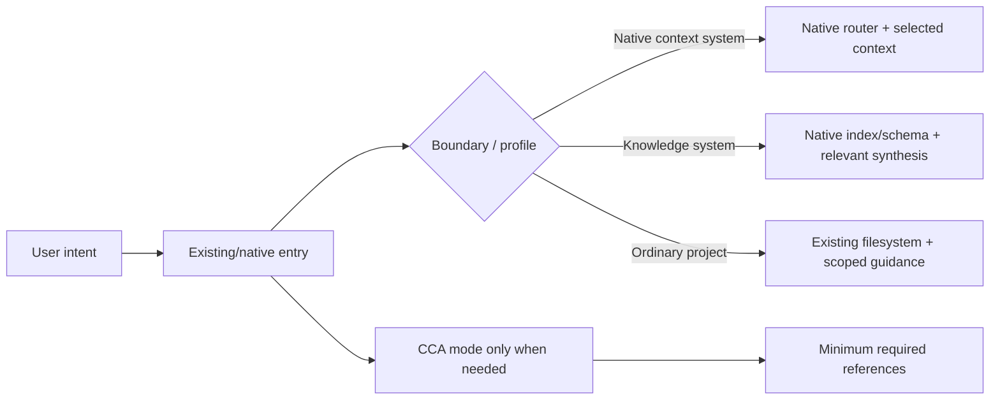

# Convergent Context Architecture

> **CCA (Convergent Context Architecture)** is an evolving, agent-agnostic interoperability layer for filesystem-native AI context. It aims to bridge human knowledge work and agentic work by building on open standards, ecosystem conventions, and proven methodologies, protocols, and frameworks, grounded in software-engineering principles and fundamentals.

CCA helps make any workspace, project, or body of human knowledge easier for both humans and AI agents to understand, navigate, and use **without forcing it into a new competing convention**.

Its goal is to make automation easier in service of augmenting human capabilities while improving efficiency, reducing technical debt and unnecessary complexity, and lowering compute, usage, and operational costs.

**Automation is the means; augmenting human capabilities is the goal.**

## In plain English

CCA does not ask every project to become a new kind of project.

A code repository can remain a code repository. A PARA second brain can remain PARA. A Zettelkasten can remain a Zettelkasten. A native ICM workspace can remain ICM. Scrum can remain the team's delivery framework. Git can remain source/history authority. An LLM Wiki can remain the maintained-knowledge layer.

CCA adds only the compatibility, routing, and context semantics needed so humans and agents can determine:

1. **Where am I?**
2. **What already governs this boundary?**
3. **What context is relevant now?**
4. **What can I change safely?**
5. **How does this boundary connect to the others?**

If the workspace is already clear, navigable, durable, and interoperable, doing nothing is a valid CCA result.

## Core rule

**Convergence over invention.**

CCA must not replace, absorb, supersede, or silently redefine an existing framework, methodology, standard, protocol, or knowledge system merely to make everything look uniform.

Preserve distinct authorities. Connect them through explicit semantics, scopes, mappings, routing, precedence, and compatibility boundaries.

## Why CCA exists

AI-assisted work increasingly depends on filesystem-native context: project instructions, routers, stage contracts, source material, maintained knowledge, reusable skills, configuration, working artifacts, human edits, and outputs.

At the same time, humans already use established knowledge-management and delivery methods, while agent ecosystems are converging on their own standards and conventions. These systems often solve different parts of the same problem, but they operate at different scopes and are not automatically interoperable.

CCA defines shared ground between them.

The objective is not one universal directory tree or one universal methodology. The objective is **interoperability, navigability, portability, durable human control, and minimum sufficient context**.

## Foundations

CCA builds on and interoperates with existing work rather than redefining it.

### Agent context and maintained knowledge

- **ICM / Model Workspace Protocol** for filesystem structure as agent architecture, staged routing, handoffs, and progressive context loading.
- **LLM Wiki** as a pattern for persistent, maintained knowledge that compounds across sessions.

### Open standards and ecosystem conventions

- **AGENTS.md** for portable, scoped agent guidance.
- **Agent Skills / `SKILL.md`** for progressively disclosed reusable capabilities.
- **MCP and other runtimes/adapters** as optional execution and tool interfaces.

### Human knowledge work

- **PARA** for action-oriented organization.
- **BASB / CODE** for knowledge-work lifecycle.
- **Zettelkasten** for durable, linked idea development.

### Engineering and delivery methods

CCA can reason about methods such as Scrum, Kanban, XP, DevOps, TDD, Lean, SAFe, LeSS, Disciplined Agile, and others without turning them into CCA-owned filesystem schemas.

Their semantics remain theirs.

## What CCA is

CCA is:

- an interoperability and composition architecture for filesystem-native context;
- a semantic layer for routing, authority, handoffs, maintained knowledge, and portability;
- a portable Agent Skill with focused, progressively disclosed modes;
- a way to preserve native behavior while connecting otherwise separate human and agent systems;
- a framework for deciding when to preserve, compose, validate, harden, scaffold, or deliberately restructure;
- an evolving compatibility layer that should adapt as its upstream standards and ecosystems evolve.

CCA is **not**:

- an agent runtime or orchestration framework;
- a real-time multi-agent message bus;
- a scheduler or queue;
- a vector database or retrieval engine;
- a replacement for MCP;
- a replacement for ICM, LLM Wiki, AGENTS.md, Agent Skills, PARA, BASB/CODE, Zettelkasten, Scrum, Kanban, XP, DevOps, SAFe, LeSS, DA, or other established systems;
- a requirement that every repository use `CONTEXT.md`, `stages/`, a wiki, a manifest, or any fixed directory tree.

## Convergence model



The arrows mean CCA can understand and connect these authorities. They do **not** mean CCA owns, replaces, or reimplements them.

## One installable skill, seven modes

CCA ships as one self-contained Agent Skill under [`skills/cca/`](skills/cca/).

```text
skills/cca/
├── SKILL.md
├── references/
│   ├── core/          # normative CCA semantics and compatibility
│   ├── architect/     # workspace forms, boundaries, builders
│   ├── advisor/       # engineering/process judgment
│   └── operations/    # scaffold, sync, ingest, query, lint
└── assets/
    └── templates/
```

| Mode | Responsibility |
|---|---|
| `architect` | Design or restructure context architecture, forms, boundaries, and compositions. |
| `scaffold` | Add the smallest useful routing/context layer without reorganizing existing content. |
| `sync` | Reconcile routing/navigation with the real filesystem. |
| `ingest` | Integrate evidence into maintained knowledge using the workspace's own schema. |
| `query` | Navigate and synthesize maintained knowledge. |
| `lint` | Validate only the compatibility/conformance profile actually claimed. |
| `advise` | Apply engineering, process, security, agent-system, context, and AI/ML judgment. |

The root [`SKILL.md`](skills/cca/SKILL.md) is a compact router. It should select the smallest applicable mode and load only the references required for the current operation.

**Progressive disclosure is part of the architecture, not merely a packaging detail.** Ordinary implementation work that does not require CCA context architecture, knowledge operations, validation, or advice should not activate deeper CCA reference material.

## Runtime authority

Normative CCA semantics are carried inside the installable skill:

- [`core/spec.md`](skills/cca/references/core/spec.md) — CCA semantics and operation model;
- [`core/compatibility.md`](skills/cca/references/core/compatibility.md) — upstream/native compatibility boundaries;
- [`core/method-composition.md`](skills/cca/references/core/method-composition.md) — composition semantics;
- [`core/adapters.md`](skills/cca/references/core/adapters.md) — harness interoperability;
- [`core/icm-inheritance.md`](skills/cca/references/core/icm-inheritance.md) — compatibility/provenance map for inherited ICM behavior.

CCA-owned documentation never overrides the active upstream authority for a native profile.

## How CCA handles common environments

### Existing code repository

Preserve the project first. Inspect its existing instructions, source tree, tests, build/package configuration, architecture documentation, backlog system, and tool-native guidance.

CCA may add compact routing when it materially improves navigation. It should not introduce pipelines, wikis, PARA folders, manifests, or other structures merely because CCA knows how to work with them.

### Human knowledge workspace

PARA, BASB/CODE, and Zettelkasten can coexist at different layers. CCA records how their boundaries relate rather than flattening them into a new taxonomy.

An LLM Wiki or other maintained agent knowledge system may coexist with human-authored durable knowledge without silently taking ownership of it.

### Native ICM

Keep it native ICM.

CCA is built on ICM principles and preserves current applicable ICM semantics when a workspace claims native ICM compatibility. Native entry behavior, routing, stage contracts, handoffs, setup/status behavior, progressive disclosure, validation, and other upstream requirements remain governed by ICM itself.

CCA may add interoperability around a native ICM boundary, but compatibility does not make that workspace CCA-owned.

### LLM Wiki

Discover and preserve the implementation's own schema and maintenance model. CCA may connect it to other workspace boundaries, but does not impose one universal LLM Wiki taxonomy.

### Delivery and engineering methods

Methods remain authorities at their own scopes. Scrum does not become a filesystem schema. TDD does not become project organization. DevOps does not become a knowledge taxonomy.

CCA helps agents identify which method governs which decision and how those scopes interact.

See [Scenarios](docs/scenarios.md) and [Method composition](docs/method-composition.md).

## Compatibility model

CCA separates three states:

| State | Meaning |
|---|---|
| **Native-compatible** | CCA can work with the upstream/native workspace without requiring structural migration, and any generated/materially rewritten native profile satisfies the applicable upstream authority. |
| **CCA-hardened** | Optional CCA routing, portability, provenance, or maintenance conventions were added without replacing native semantics. |
| **CCA-conformant** | A workspace intentionally adopts CCA-specific semantics. |

Compatibility is not ownership. An ICM workspace, LLM Wiki, codebase, PARA hierarchy, or other system does not become “CCA” merely because CCA can understand it.

## Context routing

CCA does not impose one universal router.



The common rule is: **load the smallest context that lets the agent act correctly.**

## Validation

Validate the profile actually claimed:

- native ICM → applicable current ICM acceptance surface;
- ICM-derived → only the borrowed constructs;
- native LLM Wiki → its actual maintenance/schema conventions;
- intentional CCA conformance → adopted CCA requirements;
- PARA/Zettelkasten/BASB/Scrum/etc. → their declared/local semantics rather than invented CCA certification profiles.

After profile-specific checks, CCA can apply its portability walk test:

> Can a fresh agent with no chat memory **orient, act, and report** from durable workspace context alone?

That test supplements native validation; it does not replace it.

## Getting started

1. Install or expose [`skills/cca/`](skills/cca/) to an Agent Skills-compatible agent.
2. Describe the real workspace or problem rather than requesting a CCA-shaped tree.
3. Let the skill choose the smallest applicable mode.
4. Preserve existing authorities first.
5. Validate native compatibility before optional hardening.

Examples:

- “Review this repository and add only the context routing it actually needs.” → `scaffold` / possibly `architect`.
- “Can PARA, Zettelkasten, and an LLM Wiki coexist here?” → `architect`.
- “Integrate these papers into the maintained knowledge base.” → `ingest`.
- “Validate whether this workspace satisfies its declared native profile.” → `lint`.
- “Which process or engineering trade-off should we choose?” → `advise`.

Read [Getting started](docs/getting-started.md), [FAQ](docs/faq.md), [Scenarios](docs/scenarios.md), and [Method composition](docs/method-composition.md).

## Design principles

1. **Convergence over invention.** Preserve existing authorities before adding CCA semantics.
2. **Human agency first.** Automation serves augmentation, not the reverse.
3. **Plain files as a durable interface.** Humans and agents can inspect the same state.
4. **Route the right context.** Minimum sufficient context beats indiscriminate loading.
5. **One fact, one canonical home.** Point rather than duplicate authoritative rules.
6. **Use structure only when it earns its cost.** Avoid unnecessary complexity and technical debt.
7. **Preserve native semantics before hardening.** Compatibility comes first.
8. **Compose boundaries; do not flatten methods.** Coexistence is not schema merger.
9. **Infer before serializing metadata.** Do not build manifests that merely restate obvious paths.
10. **Human-editable files are valid handoff surfaces.** Human steering remains durable.
11. **Persistent synthesis when knowledge should compound.** Avoid rebuilding durable understanding from scratch.
12. **Stable context plane, replaceable execution plane.** Models, runtimes, and providers must not own durable context.
13. **Progressive disclosure.** Load only the capability and context required for the current task.
14. **Optional infrastructure stays optional.** Databases, vector stores, MCP, queues, and orchestration may extend CCA without defining it.
15. **Efficiency is architectural.** Reduce unnecessary context, compute, usage, operational cost, and maintenance burden where correctness is preserved.

See [Design principles](docs/design-principles.md).

## Repository documentation

- [Documentation index](docs/README.md)
- [Getting started](docs/getting-started.md)
- [FAQ](docs/faq.md)
- [Scenarios](docs/scenarios.md)
- [Method composition](docs/method-composition.md)
- [Compatibility details](docs/compatibility-details.md)
- [Standards](docs/standards.md)
- [Migration](docs/migration.md)
- [References](docs/references.md)

Non-normative publication forms are under [`examples/publications/`](examples/publications/).

## Contributing

See [CONTRIBUTING.md](CONTRIBUTING.md).

Compatibility and composition changes should cite the relevant primary authority and update the complete affected surface in the same change.

## Citation

Citation metadata is provided in [CITATION.cff](CITATION.cff).

## License

MIT. See [LICENSE](LICENSE).
