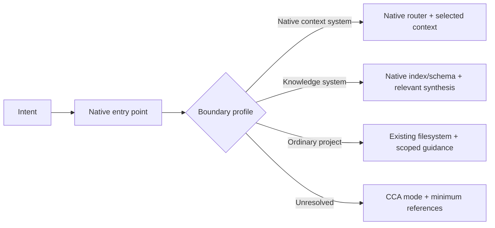
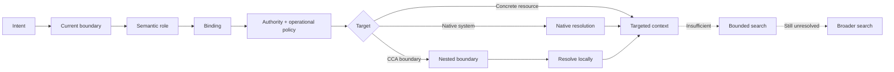

# Work in progress

Currently thinking about it's implementation and how it can be achieved without breaking the principle: **Structure must earn its cost.**

## Compatibility states

Compatibility is evaluated **per boundary**, not necessarily once for the entire workspace.

A single workspace may therefore contain boundaries in different states.

| State                 | Meaning                                                                                                                                                    |
| --------------------- | ---------------------------------------------------------------------------------------------------------------------------------------------------------- |
| **Native-compatible** | CCA can resolve and operate with the boundary while preserving the applicable external authority and native semantics.                                     |
| **CCA-hardened**      | Optional CCA semantics such as explicit bindings, authority, recovery, routing, indexing, or validation have been added without replacing native behavior. |
| **CCA-conformant**    | The boundary intentionally adopts the applicable CCA semantic contract as its own operating model.                                                         |

Compatibility is not ownership. A native ICM workspace, LLM Wiki, PARA hierarchy, code repository, Zettelkasten, or other system does not become CCA-owned because CCA can resolve it.

Likewise, CCA conformance at the outer workspace does not imply that every nested boundary must become CCA-conformant.

Partial adoption of a pattern does not confer the native state. Borrowing ICM's staged handoffs does not make a workspace native ICM.

## Context routing

There is no universal router. Resolution enters through whatever entry point already exists and dispatches on the boundary's declared profile.



The rule is constant across branches: load the smallest context that lets the agent act correctly. Broad search is the failure path, not the default.

## Validation

Validate the profile actually claimed:

- native ICM → applicable current ICM acceptance surface;
- **ICM skeleton** → cold-agent isomorphism (same walk as ICM structure; names via L0 map or default `CONTEXT.md`); not a native pipeline claim;
- ICM-derived → only the borrowed constructs;
- native LLM Wiki → its actual maintenance/schema conventions;
- CCA-hardened boundary → only the hardening semantics actually adopted;
- CCA-conformant boundary → applicable CCA requirements;
- PARA/Zettelkasten/BASB/Scrum/etc. →  preserve their locally declared semantics rather than inventing CCA certification profiles.

After profile-specific checks, CCA may apply the portability walk test:

> Can a fresh agent with no chat memory identify the current boundary, resolve the required context, act within its authority, and report what changed using durable workspace state/context alone? (**orient, act, and report** )

Failure of that test indicates missing routing, authority, state, or durable context.

That test supplements native validation; It does not replace stricter validation defined by an upstream authority.

## Getting started

1. Install or expose [`skills/cca/`](skills/cca/) to an Agent Skills-compatible agent.
2. Describe the real workspace or problem rather than requesting a CCA-shaped tree.
3. Let the skill choose the smallest applicable mode:
    1. Inspect the workspace and identify existing authorities.
    2. Identify meaningful boundaries.
    3. Determine which semantic roles are necessary at each boundary.
    4. Bind only roles whose explicit declaration improves routing, authority, or maintenance.
    5. Preserve native systems where they already solve the problem.
    6. Define mutation, concurrency, durability, recovery, and freshness only where they materially matter.
    7. Add derived indexes or caches only when they improve discovery or scale.
    8. Validate the resulting architecture with both profile-specific checks and a fresh-agent walk test.

Examples:

- “Review this repository and add only the context routing it actually needs.” → `scaffold` or `architect`
- “Design boundaries for my personal workspace, projects, wiki, and restricted client work.” → `architect`
- “Integrate these papers into maintained knowledge.” → `ingest`
- “Rebuild routing and indexes after these directories changed.” → `sync`
- “Find what we currently know about this topic.” → `query`
- “Validate this workspace and its nested native profiles.” → `lint`
- “Help choose between these engineering approaches.” → `advise`

Read [Getting started](docs/getting-started.md), [FAQ](docs/faq.md), [Scenarios](docs/scenarios.md), and [Method composition](docs/method-composition.md).

## Resolution model

CCA resolves context semantically before falling back to filesystem-wide search.

The basic resolution unit is:

```text
Boundary + Semantic Role
          ↓
        Binding
          ↓
Authority · Capabilities · Concurrency
          ↓
Durability · Recovery · Freshness · Requiredness
```

A semantic address is therefore scoped:

```text
workspace::context.router
workspace::knowledge.durable

project/cca::state.tasks
project/cca::agent.instructions

area/security-research::state.current
```

Resolution should follow this order:

1. identify the current boundary;
2. determine the applicable instructions and native authority;
3. identify the semantic role required by the current intent;
4. resolve its local or inherited binding;
5. apply its authority, mutation, concurrency, durability, recovery, and freshness rules;
6. follow the binding into the target or nested boundary;
7. delegate to that boundary's native semantics when applicable;
8. use bounded search when semantic routing is insufficient;
9. use workspace-wide search only as a fallback.



Paths are implementations. Semantic roles are interfaces.

A binding may change location or representation without changing the role it fulfills.

---

## Boundary composition

CCA workspaces may contain arbitrarily nested boundaries.

Examples include:

* projects;
* ongoing areas;
* code repositories;
* native ICM workspaces;
* maintained knowledge systems;
* restricted client workspaces;
* research collections;
* pipelines;
* record libraries.

An outer boundary may determine where a nested boundary lives and how it is discovered, but it does not automatically govern the nested boundary's internal semantics.

```text
workspace
└── project/client-platform
    ├── code
    │   └── native code-repository boundary
    └── assessment
        └── native ICM boundary
```

The outer project can route to both.

It does not need to reshape either.

**Compose boundaries; do not flatten schemas.**

---

## Validation model

CCA validation is layered.

### Static validation

Static checks evaluate properties that can be determined from durable state, such as:

* declared bindings resolve;
* required bindings exist;
* semantic addresses are unambiguous within their boundary;
* generated indexes correspond to canonical state;
* restricted content is not exposed through forbidden global indexes;
* canonical authorities are not contradicted by derived representations;
* adopted schemas are valid;
* native boundaries preserve their declared compatibility contracts;
* durable mutable state declares or inherits an appropriate recovery mechanism.

Static validation belongs in linting, pre-commit checks, CI, or equivalent deterministic tooling where useful.

### Runtime validation

Runtime checks govern operations whose validity depends on the current action or actor, such as:

* whether the requested boundary may be entered;
* whether an authority may perform the requested mutation;
* whether the capability permits `create`, `append`, `rewrite`, `move`, `delete`, `compact`, `supersede`, or another operation;
* whether another writer currently owns an exclusive mutation;
* whether volatile information is stale for the current operation;
* whether a restricted boundary was explicitly authorized;
* whether the state observed before a mutation is still current.

Static and runtime validation are complementary.

Neither substitutes for the other.

### Recoverability invariant

Durable canonical state that may be mutated must have a defined recovery model.

Examples include:

* Git history;
* append-only history;
* supersession;
* native system history;
* deterministic reconstruction.

Derived state may instead use `rebuild` or `rerun`.

Ephemeral state may be intentionally unrecoverable.

```text
durable + mutable + no recovery path
                ↓
             invalid
```

### Concurrency invariant

Mutation authority does not imply unrestricted simultaneous writes.

Bindings may declare concurrency semantics such as:

* `single-writer`;
* `single-writer/file`;
* `single-writer/object`;
* `serialized`;
* `run-isolated`;
* `build-exclusive`;
* `multi-object`;
* implementation-defined behavior where an external authority governs concurrency.

For ordinary Markdown, serialized mutation should be preferred when multiple actors may otherwise rewrite the same canonical file concurrently.

## Boundaries and semantic roles table

### Workspace Boundary

| Semantic role          | Default binding      | Authority     | Mutation capabilities             | Concurrency            | Durability | Recovery           | Freshness            | Required |
| ---------------------- | -------------------- | ------------- | --------------------------------- | ---------------------- | ---------- | ------------------ | -------------------- | -------- |
| `agent.instructions`   | `AGENTS.md`          | human         | rewrite                           | single-writer          | durable    | git                | stable               | **Yes**  |
| `context.router`       | `CONTEXT.md`         | human/shared  | rewrite                           | single-writer          | durable    | git                | on-structure-change  | **Yes**  |
| `state.current`        | `NOW.md`             | human/shared  | rewrite                           | single-writer          | durable    | git                | volatile             | No       |
| `context.capture`      | `_inbox/`            | shared        | create, append, move, delete      | multi-object           | durable    | git / archive      | TTL                  | No       |
| `work.active`          | `work/projects/`     | delegated     | create, move, archive             | multi-object           | durable    | git                | active-state         | No       |
| `work.ongoing`         | `work/areas/`        | delegated     | create, move, archive             | multi-object           | durable    | git                | periodic             | No       |
| `knowledge.reference`  | `knowledge/sources/` | shared        | create, supersede                 | multi-object           | durable    | git + supersession | source-dependent     | No       |
| `knowledge.notes`      | `knowledge/notes/`   | human         | create, rewrite, link, supersede  | single-writer/file     | durable    | git                | typed                | No       |
| `knowledge.durable`    | `knowledge/wiki/`    | human+agent   | create, rewrite, merge, supersede | single-writer/file     | durable    | git                | typed                | No       |
| `state.memory`         | `system/memory/`     | human+agent   | append, compact, supersede        | single-writer/file     | durable    | history-preserving | typed                | No       |
| `capabilities.skills`  | `system/skills/`     | human         | create, rewrite, delete           | single-writer/file     | durable    | git                | on-upstream-change   | No       |
| `procedures.workflows` | `system/workflows/`  | human         | create, rewrite                   | single-writer/file     | durable    | git                | on-process-change    | No       |
| `automation.scripts`   | `system/scripts/`    | human         | create, rewrite, delete           | single-writer/file     | durable    | git                | on-dependency-change | No       |
| `system.templates`     | `system/templates/`  | human         | create, rewrite                   | single-writer/file     | durable    | git                | stable               | No       |
| `system.assets`        | `system/assets/`     | shared        | create, rewrite, delete           | object-specific        | durable    | git / source       | n/a                  | No       |
| `history.archive`      | `_archive/`          | controlled    | move, restore                     | multi-object           | durable    | intrinsic          | none                 | No       |
| `context.index`        | `.cca/index/`        | build         | regenerate                        | build-exclusive        | derived    | rebuild            | automatic            | No       |
| `system.cache`         | `.cca/cache/`        | build/runtime | arbitrary                         | implementation-defined | ephemeral  | rebuild            | automatic            | No       |
| `system.reports`       | `.cca/reports/`      | build         | create, regenerate                | build-exclusive        | derived    | rerun              | automatic            | No       |
| `state.dashboard`      | `HOME.md`            | build         | regenerate                        | build-exclusive        | derived    | rebuild            | automatic            | No       |

### Project Boundary

| Semantic role        | Default binding                  | Authority     | Mutation capabilities   | Concurrency          | Durability | Recovery           | Freshness           | Required |
| -------------------- | -------------------------------- | ------------- | ----------------------- | -------------------- | ---------- | ------------------ | ------------------- | -------- |
| `context.router`     | `CONTEXT.md`                     | human/shared  | rewrite                 | single-writer        | durable    | git                | on-structure-change | **Yes*** |
| `agent.instructions` | `AGENTS.md`                      | human         | rewrite                 | single-writer        | durable    | git                | stable              | No       |
| `state.current`      | `NOW.md`                         | shared        | rewrite                 | single-writer        | durable    | git                | volatile            | No       |
| `state.tasks`        | `TASKS.md` or native task system | shared/native | create, rewrite, close  | serialized           | durable    | git/native history | volatile            | No       |
| `state.decisions`    | `decisions/`                     | shared        | append, supersede       | single-writer/object | durable    | preserved history  | stable              | No       |
| `work.notes`         | `notes/`                         | human/shared  | create, rewrite         | single-writer/file   | durable    | git                | typed               | No       |
| `work.artifacts`     | `artifacts/`                     | delegated     | create, rewrite         | object-specific      | durable    | git/source         | n/a                 | No       |
| `execution.runs`     | `runs/`                          | agent/runtime | create, rewrite, delete | run-isolated         | ephemeral  | rerun              | n/a                 | No       |
| `context.index`      | `.cca/index/` or inherited cache | build         | regenerate              | build-exclusive      | derived    | rebuild            | automatic           | No       |

`*` Required only when the boundary actually needs a CCA router. A plain code repository whose native structure and `AGENTS.m`d already provide sufficient routing does not need a ceremonial `CONTEXT.md`.

That preserves CCA's “structure must earn its cost” rule.

### Agents Boundary

...