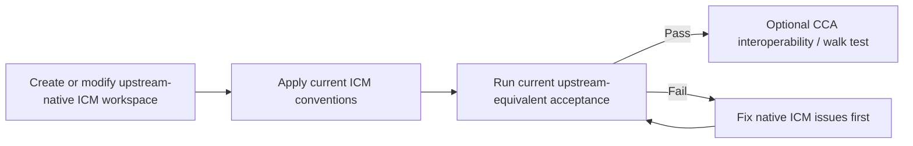

# Frameworks and Methodologies Compatibility

Explanatory. Normative compatibility semantics live in [`../skills/cca/references/core/compatibility.md`](../skills/cca/references/core/compatibility.md), with the core resolution model in [`../skills/cca/references/core/spec.md`](../skills/cca/references/core/spec.md).

## Compatibility vocabulary

CCA uses independent, composable claims:

- **Upstream-native** — passes an upstream's own current authority/acceptance rules.
- **CCA-compatible** — CCA can resolve and operate on the boundary without structural migration or semantic replacement.
- **CCA-conformant** — the boundary explicitly adopts CCA's normative interoperability model.
- **Profile-conformant** — the boundary satisfies a named optional CCA-owned profile.
- **CCA-hardened** — optional CCA capabilities were added without invalidating native semantics.
- **ICM-derived** — selected ICM patterns are used without claiming upstream-native ICM.

These are not a maturity ladder. A boundary may be upstream-native and CCA-compatible without being CCA-conformant.

## ICM compatibility

CCA accepts a valid upstream-native ICM workspace without requiring it to migrate into a CCA directory structure.

For upstream-native ICM, CCA preserves the current upstream semantics it depends on: the five-layer routing architecture, native `CLAUDE.md`, root/stage `CONTEXT.md`, exact stage contracts, selective section loading, one-way dependencies, canonical sources, numbered stage folders, human-editable `output/` handoffs, onboarding, quality gates, and other applicable upstream behavior.

A native ICM root may live inside a broader CCA, PARA, client, or coding workspace. The outer structure may determine where it lives; it must not rewrite the ICM internals merely for consistency.

### ICM-derived navigation patterns

A non-native workspace may explicitly borrow selected ICM ideas such as local contracts, progressive disclosure, selective loading, staged handoffs, one-way dependencies, or a small routing hierarchy.

That target is **ICM-derived**, not upstream-native ICM, unless the complete applicable current upstream acceptance surface passes.

ICM-derived navigation is optional. CCA does not require every compatible workspace to expose Layer 0/1/2 files, `CONTEXT.md`, per-folder contracts, a factory/product split, or native `setup`/`status` behavior. A named CCA profile may adopt some of those ideas and define its own bindings/acceptance surface.

### Does CCA conflict with ICM's workspace-builder?

It should not.

For anything claiming upstream-native ICM, current upstream ICM `_core/CONVENTIONS.md` and the applicable workspace-builder behavior remain authoritative. CCA's own architecture/scaffolding interaction is not a substitute for native acceptance.

If CCA documentation and current upstream ICM disagree, upstream ICM wins and CCA must be updated or explicitly versioned.

## LLM Wiki compatibility

CCA preserves LLM Wiki as an intentionally flexible idea pattern: durable source material plus maintained synthesis that compounds across sessions.

CCA may recommend stronger organization when useful, for example an index, provenance metadata, lifecycle fields, contradiction tracking, or a `raw/` + `wiki/` split, but these are **CCA hardening/profile choices**, not universal LLM Wiki requirements.

A pre-existing implementation should be understood through its own schema and maintenance instructions before CCA adds anything. It may live inside a PARA Resources tree or beside Zettelkasten notes without being structurally merged with them.

## Human organization and epistemic roles

Human methods and CCA semantic roles are different axes.

- **BASB/CODE** guides how knowledge moves through Capture → Organize → Distill → Express.
- **PARA** organizes actionable material into Projects, Areas, Resources, Archives.
- **Zettelkasten** supports addressable linked idea development.
- **LLM Wiki** describes persistent maintained synthesis.
- **ICM/MWP** describes filesystem-native staged routing/contracts/handoffs.
- **AGENTS.md** provides scoped portable agent instructions.
- **Agent Skills** packages focused capabilities with progressive disclosure.
- **CCA** resolves how independently governed boundaries expose stable meaning to one another.

PARA `Resources` is intentionally broader than a CCA source/reference role. A Resource may contain a source, a human note, maintained synthesis, a dataset, or a nested workspace. Crosswalks therefore describe partial/composed relationships rather than one-to-one semantic equivalence.

The composition rule is:

> **Nest boundaries; do not merge schemas merely because they coexist.**

For example, an outer PARA workspace can contain an ordinary coding repository, an upstream-native ICM client workflow, Zettelkasten notes, and an LLM Wiki-style maintained knowledge base. Each nested boundary keeps its own authority.

Read the [method composition document](method-composition.md) for the explanatory model and the [method composition specification](../skills/cca/references/core/method-composition.md) for normative rules.

## CCA Hybrid Workspace Profile

The optional Hybrid Workspace Profile is CCA-owned, profile-conformant when its frozen contract passes, and explicitly **not** upstream-native ICM merely because it adopts ICM-proven navigation ideas.

Its stable semantic keys are resolved to configurable bindings. Default paths such as `_state/`, `_runtime/`, or `CONTEXT.md` are not semantic identity.

The profile is one implementation choice for a recurring personal/team hybrid. It is not CCA itself and must not become a universal prerequisite for CCA compatibility.

## Choose the smallest workspace form

CCA starts from the work, not from a preferred tree.

| Need | Good starting form |
| --- | --- |
| Repeatable sequential workflow with explicit human handoffs | **Upstream-native ICM** when full ICM semantics are desired, or **ICM-derived stages** when only selected patterns are useful |
| Knowledge that should compound across sessions | **LLM Wiki-style maintained knowledge** |
| Human PKM / second brain | Preserve useful **PARA / Zettelkasten / BASB** organization and add agent routing only where it earns its cost |
| Existing software repository | Keep the existing repository; add only useful portable/scoped routing |
| Recurring personal/team hybrid with explicit semantics/policies | Consider the optional **CCA Hybrid Workspace Profile** |
| Several valid methods/profiles in one workspace | Compose explicit nested boundaries |
| Real-time agent-to-agent coordination | Use orchestration/message-passing infrastructure; CCA may provide durable shared context beneath it |

## Scale

CCA routing is boundary-local rather than universe-global. Large collections may add local routers, catalogs, indexes, search adapters, or derived retrieval structures at the boundary/domain that owns them.

A root bootstrap should route toward those local surfaces; it should not enumerate tens of thousands of documents. Derived indexes remain rebuildable views, and broad filesystem search remains a fallback rather than the normal navigation algorithm.
