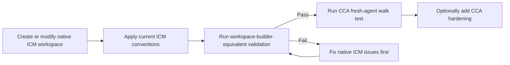

# Frameworks and Methodologies Compatibility

## ICM compatibility

CCA accepts a valid ICM workspace without requiring it to migrate into a CCA directory structure.

For native ICM, CCA preserves the ICM concepts it depends on: the five-layer routing architecture, native `CLAUDE.md`, root/stage `CONTEXT.md`, exact stage contracts, selective section loading, one-way dependencies, canonical sources, numbered stage folders, human-editable `output/` handoffs, onboarding, quality gates, and other applicable upstream patterns.

A native ICM root may live inside a broader CCA, PARA, client, or coding workspace. The outer structure may determine where it lives; it must not rewrite the ICM internals merely for consistency.

### Does CCA conflict with ICM's workspace-builder?

It should not.

The ICM workspace-builder is itself an ICM workspace whose output is a new validated ICM workspace. CCA treats upstream ICM `_core/CONVENTIONS.md` as the canonical semantic authority and the workspace-builder's final validation stage as the practical acceptance checklist for generated ICM workspaces.

CCA can provide a different architecture/scaffolding interaction, but if the result claims **native ICM compatibility**, it should pass the same applicable upstream acceptance surface. CCA's fresh-agent walk test is an additional portability check, not a replacement for ICM validation.

If CCA documentation and current upstream ICM ever disagree, upstream ICM wins and CCA should be updated.

## LLM Wiki compatibility

CCA preserves LLM Wiki as an intentionally flexible idea pattern: durable source material plus maintained LLM-owned synthesis that compounds across sessions.

CCA may recommend stronger organization when useful, for example an index, provenance metadata, lifecycle fields, contradiction tracking, or a `raw/` + `wiki/` split, but these are **CCA hardening choices**, not universal requirements of LLM Wiki.

A pre-existing LLM Wiki should be understood through its own schema and maintenance instructions before CCA adds anything. It may live inside a PARA Resources tree or beside Zettelkasten notes without being structurally merged with them.

## How the methods fit together

A concise mental model:

- **BASB/CODE** tells the human how knowledge moves: Capture → Organize → Distill → Express.
- **PARA** tells the human where actionable material belongs: Projects, Areas, Resources, Archives.
- **Zettelkasten** supports idea-level knowledge development through addressable linked notes.
- **LLM Wiki** tells the agent how persistent maintained synthesis can compound across sessions.
- **ICM/MWP** tells the agent how sequential work is routed through stages, contracts, selective context, and durable handoffs.
- **AGENTS.md** gives compatible agents scoped operating guidance.
- **Agent Skills** package focused capabilities with progressive disclosure.
- **CCA** defines how those boundaries coexist without one convention silently swallowing another.

PARA, Zettelkasten, and BASB are **method overlays**, not CCA native compatibility profiles. The core composition rule is:

> **Nest boundaries; do not merge schemas merely because they coexist.**

For example, an outer PARA workspace can contain an ordinary coding repository, a native ICM client workflow, Zettelkasten notes, and an LLM Wiki. If one nested directory is a native ICM root, an ICM-only consumer must still be able to open that directory and operate it as ICM.

Read [method composition doc`](method-composition.md) for the full model and [method composition spec](../skills/cca/references/core/method-composition.md) for the normative rules.

## Choose the smallest workspace form

CCA starts from the work, not from a preferred tree.

| Need | Good starting form |
| --- | --- |
| Repeatable sequential workflow with explicit human handoffs | **Full native ICM pipeline** if you want complete ICM semantics, or **ICM-derived stages** if you only need the stage-contract pattern inside another project |
| Knowledge that should compound across sessions | **LLM Wiki-style maintained knowledge** |
| Human PKM / second brain | Keep the useful **PARA / Zettelkasten / BASB** organization and add agent routing only where it earns its cost |
| Existing software repository | **Keep the existing repository**, add only useful portable/scoped routing |
| Several valid methods/profiles in one workspace | **Hybrid** with explicit nested boundaries |
| Real-time agent-to-agent coordination | Use an orchestration/message-passing system; CCA may provide the durable shared context beneath it |
