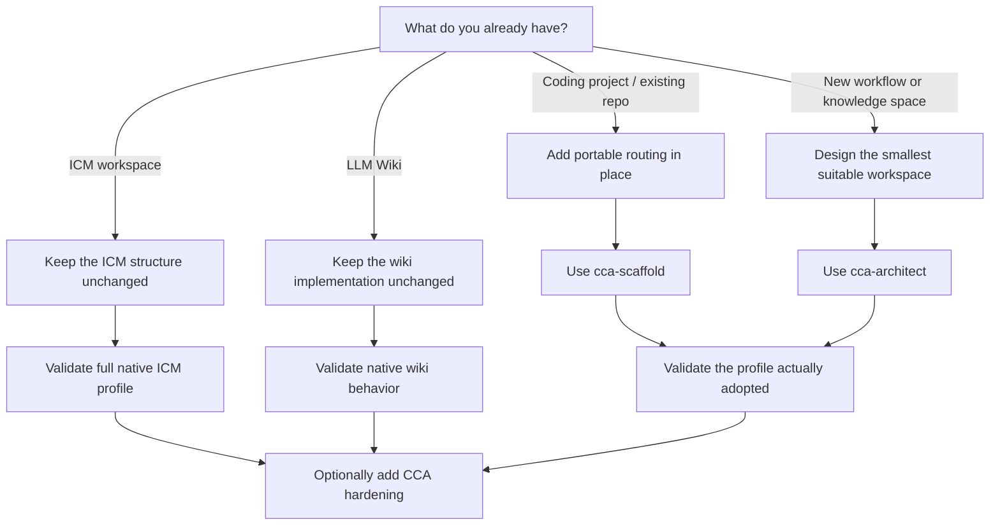
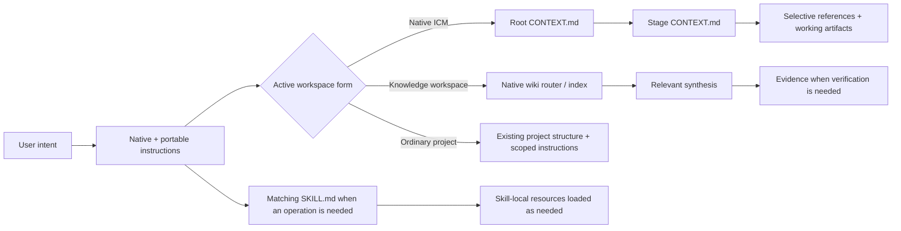

# Getting started

CCA is a filesystem-native interoperability layer for agent context. You do not install a runtime to use it. Start from the workspace you already have, then add only the structure that improves routing or portability.

## Choose your starting point



## 1. Existing ICM workspace

Do **not** rename stages, rewrite contracts, relocate references, or replace native `CLAUDE.md` behavior just to satisfy CCA. Native ICM structure is accepted as-is when it satisfies the current upstream ICM profile.

For broader agent portability, you may add a root `AGENTS.md` that routes agents into the existing ICM files while keeping `CLAUDE.md` available for ICM/Claude consumers. Do not duplicate substantive rules between them.

If you create or materially rewrite an ICM workspace, native compatibility means more than stage naming. Validate the complete applicable current ICM surface: five-layer routing, root/stage contracts, naming, output handoffs, one-way references, selective loading, `setup`/`status`, questionnaire behavior, placeholder coverage, applicable checkpoints/audits/spec/value/shared-constant patterns, tool prerequisites, quality guardrails, and workspace-builder-equivalent validation.

For new stages, keep ICM's canonical naming and contract conventions:

```text
stages/
├── 01-collect/
│   ├── CONTEXT.md
│   └── output/
└── 02-brief/
    ├── CONTEXT.md
    └── output/
```

Each stage contract keeps the ICM `Inputs` / `Process` / `Outputs` shape and uses selective section routing.

### What about ICM's workspace-builder?

CCA does not replace it and should not conflict with it.

The upstream workspace-builder is itself an ICM workspace whose output is a validated ICM workspace. For a **native ICM** claim, CCA treats upstream `_core/CONVENTIONS.md` as canonical and the workspace-builder's final validation stage as the practical acceptance checklist. If CCA's local description drifts, upstream ICM wins and CCA should be updated.

A CCA tool may build the same kind of workspace through a different user interaction, but the resulting native ICM workspace should pass the same applicable acceptance surface.

## 2. Existing LLM Wiki

Keep the implementation you already have. Karpathy's LLM Wiki is intentionally an idea pattern whose concrete schema and layout are built with the agent/user.

CCA can recognize common concepts such as durable evidence, maintained synthesis, navigation, and maintenance procedures, but it must not require CCA-specific frontmatter, page taxonomy, log syntax, or directory names for native LLM Wiki compatibility.

Add CCA hardening only when useful: portable `AGENTS.md` routing, stronger provenance conventions, lifecycle metadata, or a pipeline that consumes the wiki.

## 3. Existing coding project

Use `cca-scaffold` in quick mode. It should add context routing without reorganizing application code.

A minimal result may be:

```text
project/
├── AGENTS.md          # portable project instructions and routing
├── CONTEXT.md         # optional task/context router
├── src/
├── tests/
└── ...existing files
```

Add `_config/`, references, a wiki, or stages only when the project actually needs them.

Nested `AGENTS.md` files may be used for subprojects or packages. Follow the AGENTS.md standard: the closest applicable file wins.

If you add numbered ICM-style stages to a coding repository but do not implement the full ICM profile, describe them as **ICM-derived stage contracts** rather than calling the whole repository native ICM-compatible.

## 4. New workspace

Use `cca-architect` and start from the work, not from a preferred folder tree.

Choose the smallest form that fits:

- **Full native ICM pipeline** for a repeatable sequential workflow when you want complete ICM compatibility, including its onboarding and validation model.
- **ICM-derived pipeline** when explicit stages/handoffs help but the host project does not need the complete ICM workspace profile.
- **Knowledge bundle** for persistent synthesis that compounds across sessions.
- **Hybrid** when a pipeline consumes or updates maintained knowledge.
- **Ordinary project routing** when the existing repository structure already expresses the work well.

## How CCA routes context

CCA does not require one universal router for every form. It preserves the active profile's native entry points and adds portable routing only when useful.



## Validate before calling it done

Run `cca-lint` with the correct profile:

- **ICM native compatibility**: verify the complete applicable current ICM profile and workspace-builder-equivalent acceptance surface.
- **ICM-derived patterns**: verify the borrowed stage/routing patterns without pretending the host repository is a full native ICM workspace.
- **LLM Wiki native compatibility**: verify the core maintained-wiki behavior without imposing one concrete implementation.
- **CCA conformance**: verify the additional CCA conventions the workspace intentionally adopted.

Then perform the CCA walk test: a fresh agent should be able to orient, perform a representative operation, and report state using the files alone. The walk test supplements upstream validation; it does not replace it.

## Where CCA fits well

CCA is useful when you want one or more of these properties:

- agent context that survives across sessions and runtimes;
- plain-file state that humans can inspect, edit, diff, and version;
- selective context loading instead of one growing prompt;
- portable instructions and skills without forcing a single agent vendor;
- repeatable staged workflows with durable handoffs;
- persistent maintained knowledge that compounds over time;
- an existing coding or knowledge repository made easier for agents to navigate without restructuring it.

CCA is less useful when the problem is primarily real-time message passing, high-concurrency orchestration, queueing, scheduling, or a service/database problem. Those can sit above or beside CCA, but CCA does not try to replace them.

## Next reading

- [`../README.md`](../README.md) — project overview, mental model, and compatibility model.
- [`../spec/SPEC.md`](../spec/SPEC.md) — normative CCA specification.
- [`../spec/compatibility.md`](../spec/compatibility.md) — compatibility boundaries.
- [`migration.md`](migration.md) — optional hardening/migration paths.
- [`faq.md`](faq.md) — common usage questions.
- [`standards.md`](standards.md) — upstream conventions CCA tracks.
