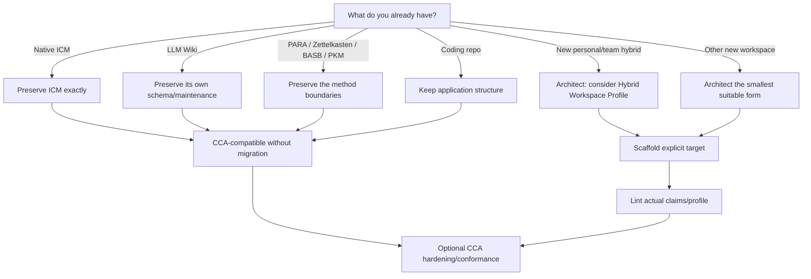
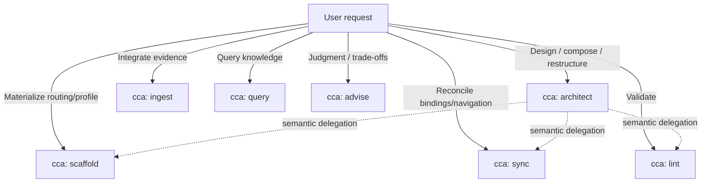

# Getting started

CCA is an evolving, agent-agnostic interoperability architecture for filesystem-native human + agent context. It is not a runtime and it does not require you to migrate an existing workspace into a universal CCA tree.

Start from what already exists. Preserve its authority, then add only the interoperability/routing/profile capabilities that improve the outcome.

The installable distribution is **one self-contained `cca` Agent Skill with seven lazily loaded modes**. Normative/runtime meaning lives inside `skills/cca/`; this document explains how to use it.

## Choose your starting point



## The core model

CCA resolves meaning through:

```text
boundary + semantic role -> binding
```

The role/key is the stable meaning. The binding is the concrete local path/implementation and may change where the governing contract permits it.

Therefore CCA does not need to rename a valid upstream workspace to understand it.

## 1. Existing native ICM workspace

Keep it native ICM.

A valid native ICM workspace is already **CCA-compatible** because CCA can resolve its native semantics without structural migration. Do not rename stages, rewrite contracts, relocate references, or replace native instruction behavior just to make CCA fit.

When native ICM is claimed, current upstream ICM remains the authority. Validate the complete applicable profile, not merely the presence of `stages/` or `CONTEXT.md`.

CCA may add optional interoperability/hardening where it does not invalidate native ICM, but that does not make ICM CCA-owned.

## 2. Existing LLM Wiki

Keep the implementation's own schema and maintenance behavior.

CCA maps persistent source material, maintained synthesis, navigation, and maintenance semantics without requiring one `raw/`, `wiki/`, index, log, or metadata shape.

Add portable routing, provenance, lifecycle, or other hardening only when useful.

## 3. Existing PARA, Zettelkasten, BASB/CODE, or second brain

Keep those methods distinct.

CCA does not convert them into a new CCA taxonomy. It maps/nests their boundaries and semantics so humans and agents can operate across them without flattening them.

For example, an outer PARA organization can contain a native ICM project, a normal code repository, human Zettelkasten notes, and an LLM Wiki. Each nested boundary keeps its own authority.

```text
workspace/
├── Projects/
│   ├── ordinary-repo/
│   └── native-icm-workflow/
├── Areas/
├── Resources/
│   ├── human-notes/
│   └── maintained-wiki/
└── Archives/
```

Use `architect` when the composition/boundaries need design. Use the human method as organization where it already fits; do not force PARA merely because CCA knows how to map it.

## 4. Existing coding project

Keep the application structure.

Use `scaffold` when you only need better portable instructions/routing. Add a router, knowledge bundle, or staged workflow only when the project actually benefits from it.

If ICM-style stage contracts are borrowed without satisfying the full upstream ICM profile, describe them as **ICM-derived**, not upstream-native ICM.

## 5. New personal/team hybrid workspace

When the desired environment combines projects, raw/preserved sources, human notes/research, maintained knowledge/wiki, tasks/state, reusable capabilities, and human + agent operation, `architect` may select the optional **CCA Hybrid Workspace Profile**.

The profile is defined and implemented completely inside the installable skill:

```text
skills/cca/
├── references/architect/hybrid-workspace.md
└── assets/hybrid-workspace/
    ├── WORKSPACE.yaml
    ├── AGENTS.md
    ├── schema.py
    ├── generate.py
    ├── audit.py
    ├── requirements.txt
    └── tests/
```

It is not a new mode and not a universal CCA tree.

Its semantic roles are stable; concrete bindings are local defaults. For example, `_state/`, `_runtime/`, `00-wiki/`, and `CONTEXT.md` are not identities.

### Initialize a target

Resolve the installed `skills/cca/` root and run the bundled tool against the intended workspace target:

```bash
python <cca-skill>/assets/hybrid-workspace/generate.py --target <workspace> --init
```

The tool intentionally requires `--target` and refuses to build inside the installed hybrid tool package. `--init` seeds missing human-authored bootstrap files without overwriting existing ones.

After authorized binding changes:

```bash
python <cca-skill>/assets/hybrid-workspace/generate.py --target <workspace>
```

Check/audit:

```bash
python <cca-skill>/assets/hybrid-workspace/audit.py --target <workspace> --self-test
python <cca-skill>/assets/hybrid-workspace/generate.py --target <workspace> --check
```

## 6. Other new workspace

Use `architect` and start from the work rather than a preferred folder tree.

Possible forms include:

- upstream-native ICM pipeline;
- ICM-derived staged workflow;
- maintained knowledge bundle;
- method-organized PKM/second brain;
- ordinary code/research repository with portable routing;
- optional CCA Hybrid Workspace Profile;
- custom CCA-compatible composition with nested boundaries.

Do not select the Hybrid profile merely because it exists. A custom or upstream-native form may be better.

## One skill, seven modes



Install only `skills/cca/`. The package contains its normative CCA semantics, compatibility rules, architecture/operation/advisor references, templates, executable profile machinery, and validation resources. Modes load progressively; they are not separate skill packages.

## Compatibility vocabulary

| Term | Meaning |
|---|---|
| **Upstream-native** | Passes an upstream's own current authority/acceptance rules. |
| **CCA-compatible** | CCA can resolve/operate without structural migration or semantic replacement. |
| **CCA-conformant** | Explicitly adopts normative CCA interoperability semantics. |
| **Profile-conformant** | Passes a named optional CCA-owned profile. |
| **CCA-hardened** | Optional CCA capabilities added without invalidating native semantics. |

These dimensions compose; they are not a maturity ladder.

## Context routing

CCA uses **route before search**:

```text
current boundary
  -> applicable authority/instructions
  -> semantic role
  -> binding/router
  -> local catalog/contract/index
  -> targeted search
  -> optional derived index
  -> broad filesystem search only as fallback
```

This is how a workspace can grow without requiring an agent to grep thousands of unrelated files every time.

## Validate before calling it done

Use `lint` against the claims the target actually makes:

- upstream-native ICM → current full ICM acceptance surface;
- ICM-derived → only borrowed constructs;
- LLM Wiki → implementation/core maintained-knowledge behavior;
- CCA-conformant → intentionally adopted CCA semantics;
- Hybrid Workspace Profile → bundled frozen-v1 audit + generated-artifact check;
- method overlays → preservation findings, not invented certification.

Then use the CCA fresh-agent walk test where applicable. It supplements stricter upstream/profile validation; it never replaces it.

## Next reading

- [`../README.md`](../README.md) — project overview and compatibility model.
- [`../skills/cca/SKILL.md`](../skills/cca/SKILL.md) — installable CCA entry/router.
- [`../skills/cca/references/core/spec.md`](../skills/cca/references/core/spec.md) — normative CCA specification.
- [`../skills/cca/references/core/compatibility.md`](../skills/cca/references/core/compatibility.md) — compatibility vocabulary and upstream preservation.
- [`../skills/cca/references/architect/hybrid-workspace.md`](../skills/cca/references/architect/hybrid-workspace.md) — optional Hybrid Workspace Profile.
- [`method-composition.md`](method-composition.md) — explanatory method composition.
- [`faq.md`](faq.md) — common questions.
- [`standards.md`](standards.md) — tracked upstream standards/conventions.
