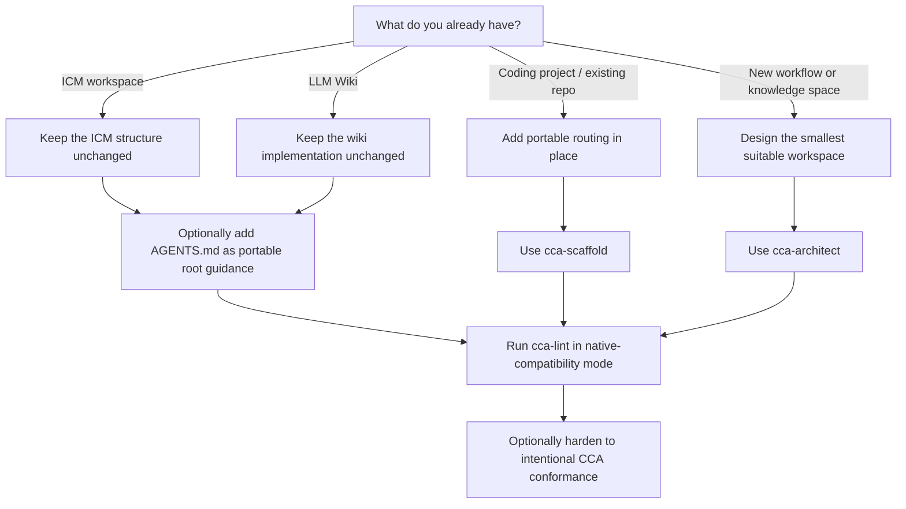
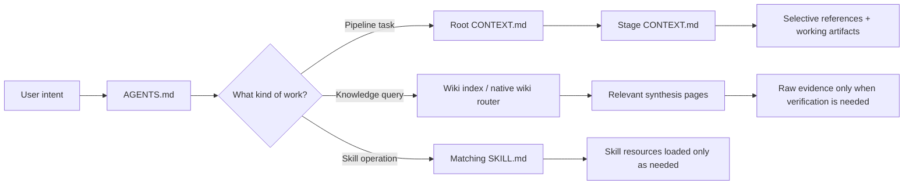

# Getting started

CCA is a filesystem-native interoperability layer for agent context. You do not install a runtime to use it. Start from the workspace you already have, then add only the structure that improves routing or portability.

## Choose your starting point



## 1. Existing ICM workspace

Do **not** rename stages, rewrite contracts, or relocate references just to satisfy CCA. Native ICM structure is accepted as-is.

For broader agent portability, add a root `AGENTS.md` that routes agents into the existing ICM files while keeping `CLAUDE.md` available for ICM/Claude consumers. Do not duplicate substantive rules between them.

If you create new stages, keep ICM's canonical naming and contract conventions:

```text
stages/
├── 01-collect/
│   ├── CONTEXT.md
│   └── output/
└── 02-brief/
    ├── CONTEXT.md
    └── output/
```

Each stage contract keeps the ICM `Inputs` / `Process` / `Outputs` shape and uses selective section routing.

## 2. Existing LLM Wiki

Keep the implementation you already have. Karpathy's LLM Wiki is intentionally an idea pattern whose concrete schema and layout are built with the agent/user.

CCA can recognize common concepts such as raw evidence, maintained synthesis, an index, and maintenance procedures, but it must not require CCA-specific frontmatter, page taxonomy, log syntax, or directory names for native LLM Wiki compatibility.

Add CCA hardening only when useful: portable `AGENTS.md` routing, stronger provenance conventions, lifecycle metadata, or a pipeline that consumes the wiki.

## 3. Existing coding project

Use `cca-scaffold` in quick mode. It should add context routing without reorganizing application code.

A minimal result is usually:

```text
project/
├── AGENTS.md          # portable project instructions and routing
├── CONTEXT.md         # optional CCA/ICM-style task router
├── _config/           # only stable project conventions worth externalizing
├── src/
├── tests/
└── ...existing files
```

Nested `AGENTS.md` files may be used for subprojects or packages. Follow the AGENTS.md standard: the closest applicable file wins.

Do not force a `wiki/` or staged pipeline into a coding project unless the work actually benefits from persistent synthesis or explicit multi-stage handoffs.

## 4. New workspace

Use `cca-architect` and start from the work, not from a preferred folder tree.

Choose the smallest form that fits:

- **Pipeline** for sequential work with explicit handoffs and review gates.
- **Knowledge bundle** for persistent synthesis that compounds across sessions.
- **Hybrid** when a pipeline consumes or updates maintained knowledge.
- Other forms only when their boundaries materially improve routing.

## Agent routing



## Validate before calling it done

Run `cca-lint` with the correct profile:

- **ICM native compatibility**: verify ICM invariants without requiring CCA-only wiki conventions.
- **LLM Wiki native compatibility**: verify the core wiki pattern without imposing one concrete implementation.
- **CCA conformance**: verify the additional CCA conventions the workspace intentionally adopted.

Then perform the walk test: a fresh agent should be able to orient, perform a representative operation, and report state using the files alone.

## Next reading

- [`../README.md`](../README.md) — project overview and compatibility model.
- [`../spec/SPEC.md`](../spec/SPEC.md) — normative CCA specification.
- [`../spec/compatibility.md`](../spec/compatibility.md) — compatibility boundaries.
- [`migration.md`](migration.md) — optional hardening/migration paths.
- [`faq.md`](faq.md) — common usage questions.
- [`standards.md`](standards.md) — upstream conventions CCA tracks.
