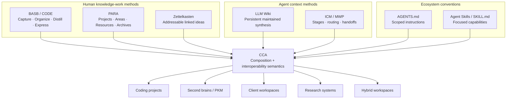
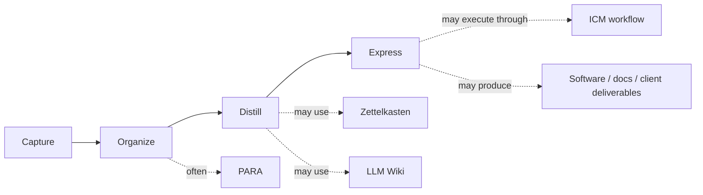
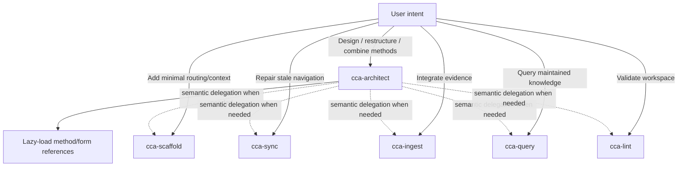

# Method composition: BASB, PARA, Zettelkasten, LLM Wiki, ICM, and CCA

CCA does not flatten these systems into one taxonomy. They solve different problems and can coexist when their boundaries remain explicit.

## The layer model

| System | Concern | Primary job |
|---|---|---|
| **Building a Second Brain / CODE** | human knowledge-work lifecycle | Capture, Organize, Distill, Express |
| **PARA** | action-oriented organization | Projects, Areas, Resources, Archives |
| **Zettelkasten** | knowledge development | small addressable ideas connected through links |
| **LLM Wiki** | agent-maintained durable knowledge | persistent synthesis that compounds across sessions |
| **ICM / MWP** | staged workflow/context architecture | route work through explicit stages, contracts, selective context, and handoffs |
| **AGENTS.md** | scoped portable instructions | tell compatible agents how to operate in repository scopes |
| **Agent Skills** | portable capabilities | package focused operational procedures with progressive disclosure |
| **CCA** | interoperability and composition | preserve those boundaries and let agents route across them without forcing one universal tree |

BASB, PARA, and Zettelkasten are **method overlays** in CCA terminology. They are not structural compatibility profiles equivalent to native ICM compatibility. CCA does not claim a universal filesystem acceptance test for them.

## How the methods relate



The arrows do not imply that every source has the same compatibility contract. CCA has explicit upstream-compatibility responsibilities toward the standards and agent-context conventions it adopts. Human methodologies are preserved as overlays unless a concrete workspace intentionally defines stricter local rules.

## BASB and PARA

BASB describes how knowledge moves through a human workflow. PARA is primarily an organization method and fits naturally within BASB's Organize step.



CCA does not claim to implement BASB. It can preserve a BASB-shaped lifecycle while routing the files, knowledge, workflows, and capabilities that participate in it.

## Zettelkasten and LLM Wiki

These can coexist without being merged into one concept.

- **Zettelkasten** is useful for idea-level development: small addressable notes, deliberate links, and evolving relationships between ideas.
- **LLM Wiki** is useful for maintained higher-level synthesis: the agent integrates sources and existing knowledge into durable pages that compound across sessions.

A workspace may keep Zettelkasten notes as human-authored/reference material while maintaining an LLM Wiki beside them. CCA must not assume every zettel is agent-writable. File authority and maintenance behavior come from the workspace's own instructions.

Example:

```text
Resources/
└── knowledge/
    ├── zettelkasten/
    │   ├── context-engineering.md
    │   ├── agent-routing.md
    │   └── progressive-disclosure.md
    └── llm-wiki/
        ├── raw/
        ├── wiki/
        │   ├── index.md
        │   ├── concepts/
        │   └── synthesis/
        └── log.md
```

The LLM Wiki tree above is only an example of a CCA-hardened implementation. Native LLM Wiki compatibility remains behavioral and implementation-flexible.

## PARA around coding, client, and ICM work

PARA can organize the outer workspace while nested projects preserve their own native semantics.

```text
workspace/
├── AGENTS.md
├── Projects/
│   ├── cca/
│   │   ├── AGENTS.md
│   │   ├── src/
│   │   └── tests/
│   └── client-acme/
│       ├── assessment/
│       │   ├── CLAUDE.md
│       │   ├── CONTEXT.md
│       │   └── stages/
│       ├── code/
│       │   ├── AGENTS.md
│       │   ├── src/
│       │   └── tests/
│       └── notes/
├── Areas/
│   ├── cybersecurity/
│   └── ai/
├── Resources/
│   └── knowledge/
└── Archives/
```

If `Projects/client-acme/assessment/` is a **native ICM root**, the outer PARA/CCA organization must not rewrite its internals to match another taxonomy. An ICM-only consumer should be able to open that nested root and operate it as ICM.

This is the core composition rule: **nest boundaries; do not merge schemas merely because they coexist.**

## Profiles versus method overlays

CCA keeps its compatibility vocabulary narrow:

- **Native-compatible** — an upstream profile remains valid and consumable without structural migration.
- **CCA-hardened** — optional CCA improvements were added without replacing the native profile.
- **CCA-conformant** — the workspace intentionally adopts CCA requirements.
- **ICM-derived** — selected ICM patterns are used without claiming full native ICM compatibility.

PARA, Zettelkasten, and BASB do not create additional native compatibility states. A workspace may instead be described informally as **PARA-organized**, **Zettelkasten-style**, or **BASB-guided** when that is useful.

## Skill routing

CCA ships a suite of focused Agent Skills. The suite is the intended capability surface; skills remain package-local so installation paths do not become architecture.



`cca` in `architect` mode is the primary entry point for compound architecture questions such as "combine PARA, Zettelkasten, LLM Wiki, and an ICM client workflow." It is **not** a mandatory gateway for direct operations. A request to lint should route directly to `cca` in `lint` mode; an ingest request should route directly to `cca` in `ingest` mode.

Cross-skill coordination is semantic, for example `Use `lint` mode to validate the selected profile.` A skill must not reach into `../cca-lint/` or another sibling's implementation files.

## Metadata discipline

CCA should infer ordinary filesystem structure when it can do so safely. Do not add a giant manifest merely to restate obvious paths such as Projects, Areas, Resources, Archives, stages, or wiki folders.

Explicit metadata is appropriate only when a real workspace-specific fact cannot safely be inferred or when the active upstream/profile already requires it. Filesystem-native context should not become YAML-native context.

## Composition invariant

A useful test for any proposed integration is:

> Can each nested native boundary still be understood by the consumer that owns that convention, while a CCA-aware agent can also understand how the boundaries relate?

If yes, the methods are composing. If one method requires silently rewriting another's native semantics, CCA should preserve the native boundary instead.
