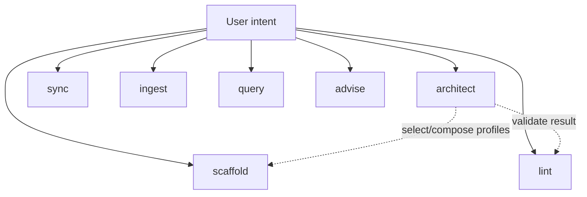

# Method composition: humans, agents, and CCA

Explanatory. Normative composition rules live inside the installable skill at [`../skills/cca/references/core/method-composition.md`](../skills/cca/references/core/method-composition.md) and compatibility vocabulary at [`../skills/cca/references/core/compatibility.md`](../skills/cca/references/core/compatibility.md).

CCA does not flatten methods, standards, or upstream systems into one taxonomy. It preserves their authority and maps the boundaries between them.

## Different systems, different jobs

| System | Primary concern |
|---|---|
| BASB / CODE | human knowledge-work lifecycle: Capture, Organize, Distill, Express |
| PARA | action-oriented organization: Projects, Areas, Resources, Archives |
| Zettelkasten | addressable linked idea development |
| LLM Wiki | persistent maintained synthesis over durable sources |
| ICM / MWP | filesystem-native agent workflow/context methodology: routing, contracts, progressive disclosure, handoffs |
| AGENTS.md | portable scoped agent instructions |
| Agent Skills / `SKILL.md` | portable progressively disclosed capabilities |
| CCA | interoperability across those systems through boundaries, semantic roles, bindings, authority, and compatibility mappings |

The important distinction is not “which tree wins?” but “which authority governs this boundary, what semantic role is needed here, and where is it bound?”

```text
boundary + semantic role -> binding
```

## Human organization and epistemic roles are different axes

An organizational shelf answers **where work is managed**. An epistemic role answers **what kind of knowledge it is**.

For example, PARA `Resources` is broader than CCA's preserved-source/reference role. A CCA profile may map a subset of Resources to `knowledge.reference`, but that is an interoperability mapping, not semantic equivalence.

Likewise:

- a Project may contain raw evidence, human notes, tasks, software, outputs, and maintained synthesis;
- a Zettelkasten note is not automatically agent-writable synthesis;
- an LLM Wiki page is not automatically a PARA Resource merely because it is informative;
- an ICM workflow can live inside a PARA Project without becoming PARA internally.

## Nested boundaries

The composition rule is:

> **Nest boundaries; do not merge schemas merely because they coexist.**

Example:

```text
workspace/
├── Projects/
│   ├── ordinary-code-repo/
│   └── client-assessment/        # upstream-native ICM boundary
├── Areas/
├── Resources/
│   ├── zettelkasten/
│   └── maintained-wiki/
└── Archives/
```

If `client-assessment/` is upstream-native ICM, current ICM remains authoritative inside that boundary. The outer method may decide where it lives; it does not rewrite the ICM internals for visual uniformity.

## ICM and CCA

ICM is not a CCA-owned profile. A valid native ICM workspace is **CCA-compatible** because CCA can resolve its native semantics without structural migration.

CCA uses ICM directly where its routing/progressive-disclosure/work-contract model is already the better abstraction. Partial borrowing remains **ICM-derived** unless the full upstream-native ICM acceptance surface passes.

A CCA-owned profile may adopt ICM-proven navigation behavior without claiming native ICM.

## Optional CCA Hybrid Workspace Profile

CCA ships an optional Hybrid Workspace Profile for a recurring case: a filesystem-native environment containing projects, preserved sources, human notes/research, maintained knowledge, tasks/state, reusable capabilities, and human + agent operation.

It is:

- CCA-owned;
- optional;
- not an eighth mode;
- not a universal CCA tree;
- not native ICM;
- implemented completely inside `skills/cca/`;
- configurable through stable semantic keys and mutable bindings.

See [`../skills/cca/references/architect/hybrid-workspace.md`](../skills/cca/references/architect/hybrid-workspace.md).

## One skill, seven modes

CCA is distributed as one `cca` Agent Skill:



Modes describe **operations**. Profiles describe **workspace contracts**. Human methodologies describe their own concerns. Those dimensions should not be collapsed into one naming system.

## Compatibility vocabulary

CCA uses independent claims:

- **Upstream-native** — passes the upstream's own current rules.
- **CCA-compatible** — CCA resolves/operates without structural migration or semantic replacement.
- **CCA-conformant** — explicitly adopts CCA's normative interoperability contract.
- **Profile-conformant** — passes a named optional CCA-owned profile.
- **CCA-hardened** — optional CCA capabilities added without invalidating native semantics.

PARA-organized, Zettelkasten-style, BASB-guided, Scrum-managed, etc. remain descriptions of independent methods, not invented CCA compatibility states.

## Metadata discipline

Do not serialize obvious filesystem facts merely because CCA can name them. Use explicit metadata when a semantic/authority/binding fact cannot safely be inferred or a selected profile/upstream requires it.

Filesystem-native context should not become YAML-native context.

## Composition test

Ask:

> Can the native consumer still understand and operate each nested boundary according to its own convention, while a CCA-aware human or agent can also resolve how those boundaries relate?

If yes, the systems are composing. If interoperability requires silently redefining one of them, preserve the original authority instead.
