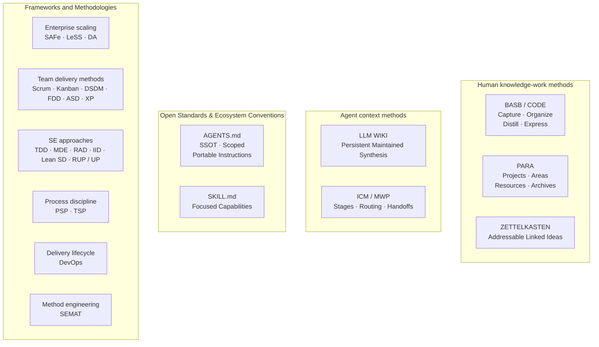
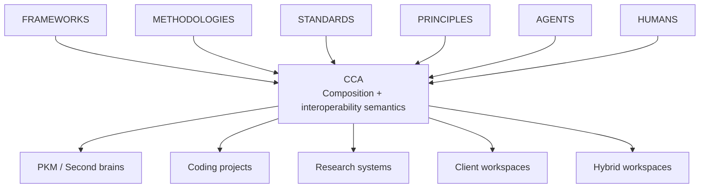

# Examples

This contains 4 folders:

1. `conversations/`: Upstream conversations with frontier web-brased LLMs
2. `publications/`: The CCA idea explained into 3 different formats: research/paper, article and blog
3. `transcripts/`: Curated set of knowledge and concepts from different distillation sources
4. `workspaces/`: example workspaces folder that serves as a mental model guidance and to prevent deviation from ICM

> [!IMPORTANT]
> Do not forget the core identity and model to be used as a guide. \
> Do not delete this file or any folder within, unless the product has been polished completely and there are no contradictions inside, \
> and the rules, principles, goals, and related, are clearly defined and explicit.

CCA (Convergent Context Architecture) is an evolving, agent-agnostic interoperability layer for filesystem-native AI context. It bridges human knowledge work and agentic work by building on open standards, ecosystem conventions, and proven methodologies, protocols and frameworks, to make any workspace, project, or body of human knowledge easier for both humans and AI agents to understand, navigate, and use, without forcing it into a new competing convention. It's goal is to make automation easier in service of augmenting human capabilities, while improving efficiency, reducing unnecessary complexity, and lowering compute, usage, and operational costs.

> While CCA’s foundational principles come from software engineering, **human principles should always take precedence**. \
> Enforcing those principles is outside CCA’s scope and level of abstraction.
> 
> CCA is not a doctrine. Use judgment and adapt to context, while keeping one core principle in mind: \
> -- **Automation is the means; augmenting human capabilities is the goal.**

## Notes

Software engineering principles are foundational guidelines that govern how systems are designed, built, and maintained, distinct from day-to-day development practices like naming conventions. Core structural principles include Modularity (breaking systems into independent components), Abstraction (hiding implementation details), Encapsulation (protecting internal state), and Separation of Concerns (isolating different functionalities). 

Key design and maintenance principles ensure long-term software health and scalability:

- **SOLID**: Five object-oriented design rules (Single Responsibility, Open-Closed, Liskov Substitution, Interface Segregation, Dependency Inversion) that prevent code deterioration. 
- **DRY** (Don't Repeat Yourself): Ensures every piece of logic exists in only one place to reduce inconsistency. 
- **KISS** (Keep It Simple, Stupid): Advocates for simple solutions over complex, clever ones to enhance readability and maintainability. 
- **YAGNI** (You Aren't Gonna Need It): Advises against implementing features until they are actually required to avoid over-engineering. 
- **Loose Coupling and High Cohesion**: Promotes components that depend minimally on each other while containing closely related functionality. 

The primary objectives of applying these principles are to control complexity, reduce defects, ensure reliability, and produce software that is maintainable and scalable over time. 
