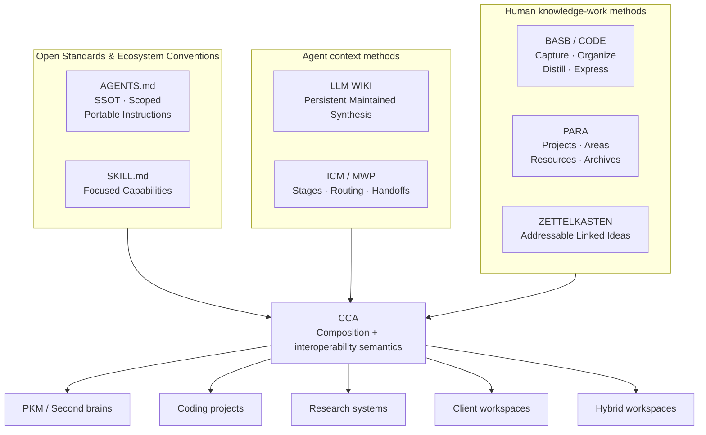
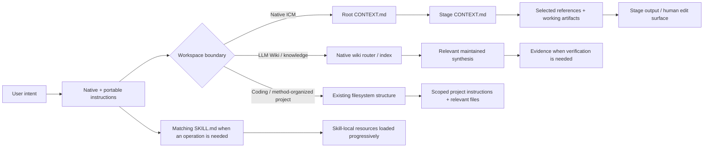
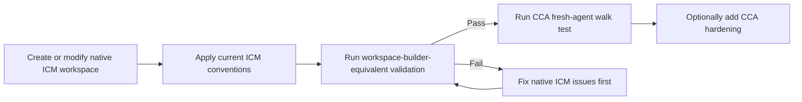
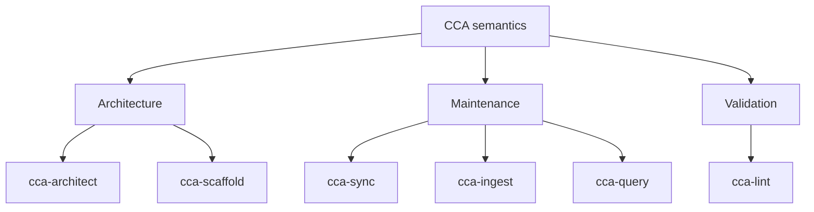
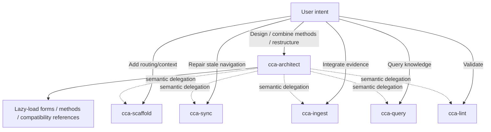
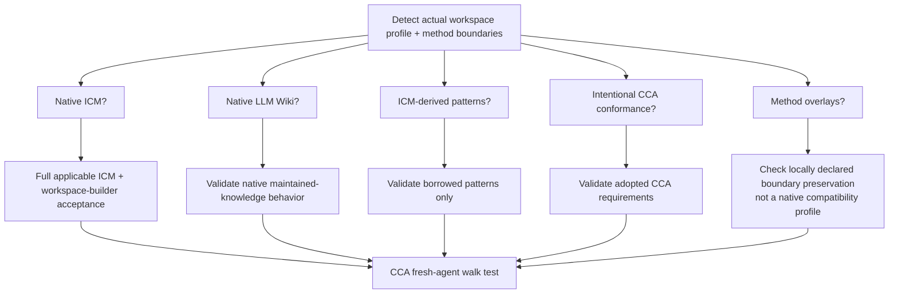

# Convergent Context Architecture

> **An Agent-Agnostic Interoperability Layer for Filesystem-Native AI Context.**

| Field | Value |
| --- | --- |
| **Document type** | Whitepaper (non-normative) |
| **Version** | DRAFT — 0.1 |
| **Status** | Working draft |
| **Date** | *(fill in)* |
| **Authors** | *(fill in)* |
| **Normative counterpart** | `spec/` |
| **License** | *(fill in)* |

## Abstract

Agent context has migrated into ordinary repositories. Instructions, task routers, stage contracts, source material, maintained knowledge, skills, configuration, and working artifacts now live as plain files alongside the work they describe. In parallel, the AI ecosystem has fragmented: vendors introduce proprietary interfaces, terminology, file formats, and platform-specific abstractions as they compete for adoption, and the resulting interoperability cost is absorbed by users who must repeatedly re-encode their knowledge for each new system.

This paper introduces **Convergent Context Architecture (CCA)**, a compatibility and composition layer for filesystem-native AI context. CCA does not propose a new organizational system. It defines shared semantics through which existing human knowledge-management methods (PARA, Building a Second Brain, Zettelkasten), agent-oriented context methods (LLM Wiki, the Interpretable Context Methodology and the Model Workspace Protocol), and ecosystem conventions (`AGENTS.md`, Agent Skills) can coexist within a single workspace without any one convention silently absorbing another.

The core contribution is a three-state compatibility model — *native-compatible*, *CCA-hardened*, *CCA-conformant* — combined with a composition rule (**nest boundaries; do not merge schemas**) and a profile-directed validation model. Together these allow a workspace to be simultaneously legible to an agent that knows only CCA, an agent that knows only the upstream method, and a human reading the files directly. We argue that this property — portability of understanding across tools, agents, and technological generations — is a precondition for human augmentation rather than mere automation.

**Keywords:** agent context, interoperability, filesystem-native, knowledge management, personal knowledge management, open standards, human augmentation, context engineering

## Table of Contents

1. [Introduction](#1-introduction)
2. [Problem Analysis](#2-problem-analysis)
3. [Related Work](#3-related-work)
4. [Design Principles](#4-design-principles)
5. [The Convergence Model](#5-the-convergence-model)
6. [Compatibility Model](#6-compatibility-model)
7. [Context Routing](#7-context-routing)
8. [Compatibility Profiles](#8-compatibility-profiles)
9. [Selecting a Workspace Form](#9-selecting-a-workspace-form)
10. [Reference Implementation: The CCA Skill Suite](#10-reference-implementation-the-cca-skill-suite)
11. [Validation Model](#11-validation-model)
12. [Rationale: Why Plain Files](#12-rationale-why-plain-files)
13. [Limitations and Boundaries](#13-limitations-and-boundaries)
14. [Adoption Paths](#14-adoption-paths)
15. [Future Work](#15-future-work)
16. [Conclusion](#16-conclusion)
- [References](#references)
- [Appendix A: Native ICM Stage Contract](#appendix-a-native-icm-stage-contract)
- [Appendix B: Glossary](#appendix-b-glossary)
- [Appendix C: Compatibility Decision Reference](#appendix-c-compatibility-decision-reference)

## 1. Introduction

### 1.1 Document status and normative scope

This whitepaper is **non-normative**. It presents the motivation, architecture, and rationale behind CCA. Normative requirements — the rules an implementation must satisfy to claim conformance — live in the `spec/` directory, principally `spec/method-composition.md`.

Where this document and the normative specification disagree, the specification governs. Where the specification and a current upstream convention disagree, **the upstream convention governs and CCA is expected to change toward it.** This precedence order is itself a design commitment, discussed in §4.

### 1.2 Contributions

This paper makes four contributions:

1. **A layered analysis of the context-fragmentation problem** that separates human cognitive organization, agent execution semantics, and ecosystem interoperability into distinct concerns (§2, §3).
2. **A three-state compatibility model** distinguishing what CCA can *consume*, what CCA has *augmented*, and what has *intentionally adopted* CCA (§6).
3. **A composition rule for nested methods** that permits multiple valid organizational schemas to coexist in one workspace without structural merging (§5.3, §8).
4. **A profile-directed validation model**, including a portability check (the *fresh-agent walk test*) that supplements rather than replaces upstream acceptance criteria (§11).

### 1.3 Intended audience

Practitioners designing agent workflows over real repositories; maintainers of knowledge-management or agent-context conventions considering interoperability; and technical readers evaluating whether a shared semantic layer is warranted before adopting a vendor-specific abstraction.

## 2. Problem Analysis

### 2.1 Context has moved into the filesystem

Rapid advances in artificial intelligence are changing how knowledge is produced, maintained, retrieved, and acted upon at a pace that existing human workflows, institutions, and technical conventions often struggle to absorb. One consequence is structural: agent context is increasingly stored in ordinary repositories rather than in application state. Instructions, task routers, stage contracts, source material, maintained knowledge, skills, configuration, and working artifacts are all now files.

This is a favorable development. Files are inspectable, versionable, and portable. But it exposes a second-order problem: files carry no inherent agreement about what they mean.

### 2.2 Fragmentation as a cost transfer

The AI ecosystem remains highly fragmented. Vendors introduce proprietary interfaces, terminology, semantics, file formats, workflow conventions, and platform-specific abstractions as they compete for adoption. Each such abstraction is locally rational and globally expensive: it raises interoperability costs and increases the cognitive burden placed on users, who must repeatedly adapt their knowledge, tools, and workflows to changing systems.

These pressures coexist with rising infrastructure and software costs, broader economic constraints, and growing uncertainty regarding the effect of AI-enabled automation on employment and professional roles. Fragmentation is therefore not a neutral technical inconvenience; it is a transfer of cost from vendors to users at a moment when users are least able to absorb it.

### 2.3 The resulting knowledge asymmetry

The knowledge asymmetry produced by this environment is substantial. Some individuals respond by attempting to continuously acquire new technical knowledge out of concern that their existing skills may become obsolete, while others remain largely disconnected from even basic concepts surrounding modern AI systems. Between these groups lies an expanding market for education, consulting, tooling, and expertise.

Where knowledge is scarce and terminology evolves rapidly, the environment also creates incentives for overstated expertise, low-quality guidance, and the commercialization of complexity itself. The consequence is not merely technical fragmentation, but an increasing disparity in the ability of individuals to understand, evaluate, and meaningfully participate in technological change.

### 2.4 Automation is a mechanism; augmentation is the objective

A sustainable response requires more than improved automation. Humans must retain the ability to understand the systems with which they interact, preserve control over their knowledge, and transfer that knowledge across tools and technological generations. On this reading, knowledge sharing and interoperability are mechanisms for preserving human agency, not merely for improving computational efficiency.

The objective of artificial intelligence should therefore not be automation as an end state. Automation is a mechanism through which human capability may be extended. The underlying objective is **human augmentation**: enabling individuals to reason, create, organize, communicate, and act with greater leverage while retaining meaningful control over those processes.

The same pattern is observable in earlier general-purpose technologies — transportation, telecommunications, and the Internet — where the most consequential effects came not from replacing human activity wholesale, but from expanding the scale and reach of what humans could accomplish.

### 2.5 Problem statement

The problem is **not** an absence of knowledge-management methodologies or agentic workflow architectures. Several mature systems already exist at each layer, and none of them requires replacement by a single universal alternative.

The problem is the **absence of a shared semantic layer** through which these approaches can coexist without requiring humans, agents, editors, tools, and runtimes to adopt one competing organizational system. Without such a layer, the same underlying knowledge is interpreted differently depending on the agent, vendor, application, or execution environment consuming it — and the boundaries between coexisting methods are resolved inconsistently or not at all.

Stated as a requirement: what is missing is a sufficiently portable and interoperable way to connect existing methods while preserving their respective strengths, their human comprehensibility, and their technological independence.

## 3. Related Work

Existing work addresses parts of this problem at three distinct layers. Recognizing that they operate at *different* layers is what makes composition possible rather than competitive.

### 3.1 Human knowledge-work methods

**PARA** organizes actionable material by horizon of commitment: Projects, Areas, Resources, Archives. It answers *where does this belong?*

**Building a Second Brain (BASB)** and its CODE loop — Capture, Organize, Distill, Express — describe how knowledge moves through a lifecycle from raw capture to expressed output. It answers *what happens to this over time?*

**Zettelkasten** supports idea-level knowledge development through small, addressable, densely linked notes. It answers *how do ideas connect and compound?*

These optimize for human cognition, organization, and long-term intellectual development. They say nothing about machine consumption, and were never intended to.

### 3.2 Agent-oriented context methods

**LLM Wiki**, as introduced by Andrej Karpathy, describes a pattern in which persistent knowledge is incrementally synthesized and improved across interactions rather than repeatedly reconstructed from transient conversational context. Its essential claim is that maintained synthesis compounds where conversation does not.

**The Interpretable Context Methodology (ICM)** is a framework for structuring context so that AI interactions remain understandable and effective. **The Model Workspace Protocol (MWP)** is used in conjunction with ICM to manage the workspace and its stage-gated contracts. Together they constitute a **Product Development Life Cycle (PDLC)** framework addressing filesystem-native organization for token efficiency, staged workflows, explicit routing, durable handoffs, and human-reviewable state.

These optimize for context retrieval, execution, persistence, and coordination.

### 3.3 Ecosystem conventions and open standards

**`AGENTS.md`** provides compatible agents with scoped, portable operating guidance from a single source of truth.

**Agent Skills** (`SKILL.md`) package focused capabilities with progressive disclosure, so that instructions and resources load only when the capability is invoked.

These optimize for interoperability between tools and implementations.

### 3.4 The unresolved gap

Each layer is well served in isolation. What is unresolved is the interface *between* layers, and the interface between two instances of the same layer inside one workspace.

Concretely: a repository may contain a PARA tree, a native ICM pipeline, a maintained LLM Wiki, and Zettelkasten notes. Each is individually valid. Nothing today specifies how an agent should determine which boundary it is inside, which conventions govern that boundary, and what it may add without breaking the native semantics.

CCA addresses exactly that gap.

## 4. Design Principles

CCA is governed by five principles. They are stated here because most of the specification's detail is derivable from them.

**P1 — Preservation over replacement.**
When an upstream convention, open standard, or existing method already solves the problem, preserve it. This is the core rule; every other principle is subordinate to it.

**P2 — Upstream precedence.**
If an upstream convention changes, CCA changes toward it rather than freezing a near-compatible fork. Where CCA documentation and current upstream disagree, upstream wins and CCA is updated. Near-compatible variants are treated as defects, not as flexibility.

**P3 — Minimal sufficient context.**
Load the smallest context that lets the agent act correctly. This applies to routing, to skill disclosure, and to scaffolding decisions alike.

**P4 — Boundaries nest; schemas do not merge.**
Coexistence is not integration. Two methods in one workspace remain two methods with an explicit boundary between them.

**P5 — Inferred structure over declared structure.**
Ordinary filesystem semantics should be inferred where it is safe to do so. A central manifest that merely restates obvious paths — Projects, Areas, Resources, Archives, numbered stages, wiki folders, skill collections — is overhead, not architecture.

## 5. The Convergence Model

### 5.1 What CCA is

CCA **is**:

- a compatibility and composition layer for filesystem-native agent context;
- a set of shared semantics for routing, durable knowledge, handoffs, authority boundaries, and portability;
- a focused Agent Skills suite for designing, scaffolding, maintaining, querying, and validating workspaces;
- a way to add cross-agent guidance without destroying native tool behavior;
- a framework for deciding when to preserve, harden, intentionally conform, or simply compose existing methods.

### 5.2 What CCA is not

CCA **is not**:

- an agent runtime or orchestration framework;
- a real-time multi-agent message bus;
- a scheduler or queue;
- a vector database or retrieval engine;
- a replacement for MCP;
- a replacement for ICM, LLM Wiki, PARA, BASB, or Zettelkasten;
- a requirement that every repository use stages, a wiki, `CONTEXT.md`, a large manifest, or one fixed directory tree.

### 5.3 The five orientation questions

CCA defines the shared ground between human methods and agent methods such that an agent can answer five questions without forcing a migration:

1. **What type of workspace or boundary is this?**
2. **What context should I load for this task?**
3. **What capability should the operation perform?**
4. **What source conventions or methods already govern it?**
5. **What can I add without altering the native semantics?**

The objective is not to make every workspace look the same. The objective is to make different valid workspace forms **interoperable, navigable, and portable**.

### 5.4 Layer composition

CCA composes several layers of prior art. These are not all the same kind of standard, and the model does not treat them as interchangeable inputs.

**Figure 1 — Layer composition.**



Human methodologies remain **method overlays** unless CCA deliberately adopts a concrete machine-facing contract from them in a future revision. This distinction is load-bearing: overlays are preserved and composed at their boundaries, but they do not create native compatibility profiles (§6.2).

### 5.5 Role summary

| Layer | Component | What it determines |
| --- | --- | --- |
| Human | BASB / CODE | How knowledge moves: Capture → Organize → Distill → Express |
| Human | PARA | Where actionable material belongs |
| Human | Zettelkasten | How ideas are addressed and linked |
| Agent | LLM Wiki | How persistent maintained synthesis compounds across sessions |
| Agent | ICM / MWP | How sequential work is routed through stages, contracts, selective context, and durable handoffs |
| Standards | `AGENTS.md` | Scoped operating guidance for compatible agents |
| Standards | Agent Skills | Focused capabilities with progressive disclosure |
| **Composition** | **CCA** | **How those boundaries coexist without one convention silently swallowing another** |

---

## 6. Compatibility Model

### 6.1 Three states

CCA deliberately separates three states. Conflating them is the most common way an interoperability layer becomes an occupying one.

| State | Meaning |
| --- | --- |
| **Native-compatible** | CCA can consume the upstream workspace without structural migration, and any generated or materially rewritten native profile satisfies that upstream's applicable acceptance surface. |
| **CCA-hardened** | Optional CCA routing, portability, provenance, or maintenance conventions were added *without* replacing the native profile. |
| **CCA-conformant** | The workspace intentionally adopts the CCA specification. |

An ICM workspace or an LLM Wiki does not become "CCA" merely because CCA can understand it. Consumption is not annexation.

### 6.2 Native versus derived

CCA further distinguishes **native ICM** from **ICM-derived**.

A coding repository may borrow numbered stages, stage contracts, or output handoffs because those patterns are useful in isolation. Borrowing does not make the repository a native ICM workspace unless the full applicable ICM profile also passes validation.

This distinction prevents two failure modes: overclaiming compatibility that will not survive contact with an ICM-only consumer, and over-validating a repository against a profile it never adopted.

### 6.3 Method overlays

PARA, Zettelkasten, and BASB do **not** create additional native compatibility states. They are preserved and composed at their boundaries. A workspace organized with PARA is not "PARA-conformant" in any machine-checkable sense; it is a workspace whose PARA boundary CCA must not rewrite.

---

## 7. Context Routing

CCA does not impose a universal router. It preserves the native entry point of the active workspace and adds portable guidance only where that guidance earns its cost.

**Figure 2 — Routing by workspace boundary.**



The routing principle is invariant across forms: **load the smallest context that lets the agent act correctly** (P3).

Consistent with P5, CCA infers ordinary filesystem semantics where it can do so safely. A central YAML manifest is not required to restate paths that the directory structure already communicates.

---

## 8. Compatibility Profiles

### 8.1 ICM

CCA accepts a valid ICM workspace without requiring migration into a CCA directory structure.

For native ICM, CCA preserves the concepts it depends on: the five-layer routing architecture, native `CLAUDE.md`, root and stage `CONTEXT.md`, exact stage contracts, selective section loading, one-way dependencies, canonical sources, numbered stage folders, human-editable `output/` handoffs, onboarding, quality gates, and other applicable upstream patterns.

A native ICM root may live inside a broader CCA, PARA, client, or coding workspace. The outer structure may determine *where* it lives; it must not rewrite ICM internals for the sake of consistency.

#### 8.1.1 Relationship to the ICM workspace-builder

The ICM workspace-builder is itself an ICM workspace whose output is a new validated ICM workspace. There is an apparent conflict here — two systems that both scaffold ICM workspaces — and it resolves cleanly under P2.

CCA treats upstream ICM `_core/CONVENTIONS.md` as the canonical semantic authority, and the workspace-builder's final validation stage as the practical acceptance checklist for generated ICM workspaces. CCA may offer a different architecture and scaffolding interaction; but if the result claims **native ICM compatibility**, it must pass the same applicable upstream acceptance surface.

CCA's fresh-agent walk test (§11.2) is an *additional* portability check, never a substitute for ICM validation.

**Figure 3 — Validation order for ICM workspaces.**



### 8.2 LLM Wiki

CCA preserves LLM Wiki as an intentionally flexible idea pattern: durable source material plus maintained, LLM-owned synthesis that compounds across sessions.

CCA may *recommend* stronger organization where useful — an index, provenance metadata, lifecycle fields, contradiction tracking, or a `raw/` plus `wiki/` split. These are **CCA hardening choices**, not universal requirements of LLM Wiki, and the distinction should be stated explicitly whenever such a recommendation is made.

A pre-existing LLM Wiki must be understood through its own schema and maintenance instructions before CCA adds anything. It may live inside a PARA Resources tree or beside Zettelkasten notes without being structurally merged with either.

### 8.3 Method overlays and the composition rule

> **Nest boundaries; do not merge schemas merely because they coexist.**

An outer PARA workspace may contain an ordinary coding repository, a native ICM client workflow, Zettelkasten notes, and an LLM Wiki. If one nested directory is a native ICM root, an ICM-only consumer must still be able to open that directory and operate it as ICM — with no knowledge of PARA, of CCA, or of the surrounding tree.

This is the operational test for whether composition succeeded.

*Full model: [`docs/method-composition.md`](docs/method-composition.md). Normative rules: [`spec/method-composition.md`](spec/method-composition.md).*

## 9. Selecting a Workspace Form

CCA starts from the work, not from a preferred tree. The correct form is the smallest one that supports the actual workflow.

| Need | Recommended starting form |
| --- | --- |
| Repeatable sequential workflow with explicit human handoffs | **Full native ICM pipeline** for complete ICM semantics, or **ICM-derived stages** if only the stage-contract pattern is needed inside another project |
| Knowledge that should compound across sessions | **LLM Wiki-style maintained knowledge** |
| Human PKM / second brain | Keep the existing **PARA / Zettelkasten / BASB** organization; add agent routing only where it earns its cost |
| Existing software repository | **Keep the repository as-is**; add only useful portable or scoped routing |
| Several valid methods or profiles in one workspace | **Hybrid**, with explicit nested boundaries |
| Real-time agent-to-agent coordination | Use an orchestration or message-passing system; CCA may provide the durable shared context beneath it |

## 10. Reference Implementation: The CCA Skill Suite

CCA ships six focused Agent Skills as a single capability suite. No runtime installation is required to use CCA itself; the skill suite is distributed so that focused capabilities can be discovered progressively.

| Skill | Purpose |
| --- | --- |
| [`cca-architect`](skills/cca-architect/) | Design and restructure compound workspaces, choose forms, preserve boundaries, coordinate focused CCA operations |
| [`cca-scaffold`](skills/cca-scaffold/) | Add the smallest useful routing and context layer without restructuring existing content |
| [`cca-sync`](skills/cca-sync/) | Reconcile routing and navigation with disk while preserving scope and native semantics |
| [`cca-ingest`](skills/cca-ingest/) | Integrate new evidence into maintained knowledge using the workspace's own schema |
| [`cca-query`](skills/cca-query/) | Query maintained synthesis and verify against source evidence as needed |
| [`cca-lint`](skills/cca-lint/) | Validate the correct native or conformance profile; separate hard failures, method-preservation findings, and optional hardening |

**Figure 4 — Capability grouping.**



### 10.1 Why six skills rather than one

The split exists for precise triggering and progressive disclosure. A monolithic skill loads irrelevant instructions on every invocation and triggers imprecisely.

`cca-architect` is the primary entry point for **compound architecture** questions. It is explicitly *not* a mandatory router for every request: a direct lint request activates `cca-lint`; a direct ingest request activates `cca-ingest`.

**Figure 5 — Intent-to-skill routing.**



### 10.2 Semantic delegation

Cross-skill coordination uses semantic capability names — for example, *"Use `cca-lint` to validate the selected profile"* — rather than filesystem paths.

A skill must not reach into a sibling skill directory or a repository-global implementation file by relative path. This constraint preserves skill portability: installation layout is not part of the capability contract. It does **not** imply that every CCA skill must function as an unrelated standalone product.

## 11. Validation Model

### 11.1 Profile-directed validation

Validation follows the *active* profile rather than imposing the strictest known schema on everything. Applying ICM's acceptance surface to a plain coding repository produces noise, not safety.

**Figure 6 — Validation flow.**



### 11.2 The fresh-agent walk test

The walk test asks a single question: **can a fresh agent with no chat memory orient, act, and report using only the durable workspace?**

- **Orient** — determine which boundary it is in and which conventions govern it.
- **Act** — locate and load the minimum context required for the requested operation.
- **Report** — write results to the declared, human-reviewable edit surface.

The test is useful across all profiles. It never overrides stricter upstream acceptance criteria; a workspace that passes the walk test but fails native ICM validation is not native-compatible.

## 12. Rationale: Why Plain Files

### 12.1 Portability

A filesystem-native workspace can be copied, versioned, inspected, edited, or handed to another compatible agent without a proprietary state store. CCA treats databases, vector indexes, MCP servers, and orchestration as optional infrastructure *around* the durable workspace, rather than prerequisites for understanding it.

### 12.2 Observability

Instructions, references, intermediate artifacts, and maintained knowledge remain visible as files. When a result is wrong, a human can inspect the exact router, contract, reference, or prior artifact involved, instead of reasoning about opaque runtime state.

This is the difference between a system that can be debugged and one that can only be re-run.

### 12.3 Human augmentation

Automation is infrastructure; augmentation is the objective (§2.4). Durable edit surfaces let agents absorb repetitive context and navigation work while humans retain the ability to inspect, steer, revise, and veto the state that subsequent operations consume.

The veto is the point. A workspace where the human cannot intervene between stages has automated a process without augmenting anyone.

### 12.4 Where CCA fits well

CCA is a strong fit where the work benefits from persistent context across sessions; portability across agents, editors, and runtimes; selective context loading; human-readable and versionable state; repeatable stage handoffs; maintained knowledge that compounds; PKM methods connected to agent workflows without being replaced; scoped instructions in an existing codebase; and optional rather than mandatory infrastructure.

## 13. Limitations and Boundaries

CCA deliberately does not solve every systems problem. The following are out of scope by design, not by omission.

**Real-time multi-agent collaboration.** Agents communicating dynamically in tight loops require message-passing and orchestration infrastructure. CCA has no mechanism for this and should not acquire one.

**High-concurrency shared services.** These require queueing, isolation, locking and transactions, deployment, and related runtime concerns.

**Complex automated branching or scheduling.** These may require a workflow engine. CCA can supply the durable context and contracts such a runtime consumes.

**Large-scale retrieval.** This may benefit from databases, embeddings, indexes, or graph systems. These are compatible extensions, provided the durable workspace remains understandable without treating the external index as the sole source of truth.

A further, softer limitation: CCA's value is proportional to the number of coexisting methods in a workspace. A single-method repository with one agent gains little from an explicit composition layer, and adopting one there is overhead.

## 14. Adoption Paths

No CCA runtime installation is required. Use the repository files with any agent capable of reading them. When using the first-party skills, install or distribute the CCA skill suite so capabilities can be discovered progressively.

### 14.1 Existing ICM workspace

Keep it as ICM. Do not rename stages, replace `CLAUDE.md`, rewrite contracts, or relocate references merely to satisfy CCA. Run `cca-lint` in **ICM native compatibility** mode. Add CCA hardening only after native validation passes.

### 14.2 Existing LLM Wiki

Keep its schema and maintenance model. Run `cca-lint` in **LLM Wiki native compatibility** mode. Add optional CCA routing or provenance conventions only where they solve an observed problem.

### 14.3 Existing PARA / Zettelkasten / BASB system

Keep it. Use `cca-architect` when connecting or restructuring several methods, or when introducing nested workflow and knowledge boundaries. CCA should preserve the existing method and add only the routing agents need to understand it.

### 14.4 Existing coding project

Use `cca-scaffold` in its default quick mode. The useful change is often only a root `AGENTS.md` plus scoped instructions for specific subtrees. `CONTEXT.md`, stages, a wiki, and `_config/` are optional.

Do not reorganize application code around CCA unless the user explicitly requests restructuring.

### 14.5 New workspace

Use `cca-architect`. Describe the real workflow or knowledge problem first and let the form follow from it. Request the **full native ICM profile** for a complete ICM workspace; request **ICM-derived stages** if only sequential stage contracts are needed inside another repository.

*Detailed paths: [`docs/getting-started.md`](docs/getting-started.md). Common questions on Obsidian, VS Code, coding projects, second brains, MCP, databases, nested `AGENTS.md`, and multi-agent work: [`docs/faq.md`](docs/faq.md).*

## 15. Future Work

The following are open and explicitly unresolved in this revision:

1. **Machine-facing contracts for human methods.** PARA, BASB, and Zettelkasten currently remain method overlays. Whether any of them warrants promotion to a native compatibility profile — and what acceptance surface that would require — is undetermined.
2. **Boundary declaration mechanics.** §8.3 states the composition rule; the minimal syntax by which a nested boundary declares its own profile without introducing a central manifest (P5) requires further specification.
3. **Formalizing the walk test.** The orient/act/report criteria are currently qualitative. A reproducible procedure would make cross-implementation comparison meaningful.
4. **Upstream tracking policy.** P2 commits CCA to following upstream changes. The cadence, deprecation window, and conflict-resolution process for that tracking are not yet defined.
5. **Empirical evaluation.** No measurements are reported here on context-loading efficiency, error rates under profile-directed versus uniform validation, or portability across agent implementations.

## 16. Conclusion

The proliferation of AI-specific formats, terminologies, and platform abstractions is not a transient condition, and waiting for a single winner is not a strategy. Meanwhile, the methods that already work — human ones for organizing thought, agent-oriented ones for structuring execution, and open conventions for interoperability — operate at different layers and are not in genuine competition with one another.

CCA proposes that the missing piece is not another organizational system but a thin semantic layer that lets the existing ones coexist: a three-state compatibility model that distinguishes consumption from adoption, a composition rule that nests boundaries instead of merging schemas, and validation that follows the profile actually in use.

The measure of success is negative rather than positive. A CCA workspace should be one where an ICM-only agent still sees ICM, a human still sees their own filing system, and neither has to know CCA exists.

## References

> **Note to author:** entries marked *[verify]* require a canonical URL, version, or citation before publication. Do not publish with placeholders.

1. Forte, T. *Building a Second Brain: A Proven Method to Organize Your Digital Life and Unlock Your Creative Potential.* Atria Books, 2022. — PARA and the CODE lifecycle.
2. Ahrens, S. *How to Take Smart Notes.* 2nd ed., 2022. — Contemporary treatment of the Zettelkasten method, after Niklas Luhmann.
3. Karpathy, A. *LLM Wiki.* — Pattern for persistent, incrementally synthesized knowledge that compounds across sessions. *[verify: canonical source URL and date]*
4. *Interpretable Context Methodology (ICM).* — Filesystem architecture for staged, human-reviewable agent workflows. See upstream `_core/CONVENTIONS.md`. *[verify: repository URL and version]*
5. *Model Workspace Protocol (MWP).* — Workspace and stage-gated contract management, used with ICM to form a PDLC framework. *[verify: repository URL and version]*
6. *AGENTS.md.* — Open convention for scoped, portable agent instructions. https://agents.md *[verify: current spec revision]*
7. *Agent Skills (`SKILL.md`).* — Packaging format for focused capabilities with progressive disclosure. *[verify: canonical specification URL]*
8. *Model Context Protocol (MCP).* — https://modelcontextprotocol.io *[verify: current spec revision]*
9. *Open standard.* Wikipedia. https://en.wikipedia.org/wiki/Open_standard

### Internal references

- [`spec/method-composition.md`](spec/method-composition.md) — normative composition rules
- [`docs/method-composition.md`](docs/method-composition.md) — full composition model
- [`docs/getting-started.md`](docs/getting-started.md) — adoption paths
- [`docs/standards.md`](docs/standards.md) — profile details
- [`docs/faq.md`](docs/faq.md) — common questions

## Appendix A: Native ICM Stage Contract

When the ICM profile is active, CCA preserves the upstream contract shape rather than inventing a near-equivalent variant (P2).

```markdown
## Inputs

| Source         | File/Location               | Section/Scope | Why             |
| -------------- | --------------------------- | ------------- | --------------- |
| Previous stage | `../01-research/output/`    | Full file     | Source material |
| Style guide    | `../../references/voice.md` | "Voice Rules" | Tone guidance   |

## Process

1. Read the routed inputs.
2. Perform the stage's single job.
3. Run applicable checkpoints/audits.
4. Write the declared output.

## Outputs

| Artifact | Location                  | Format   |
| -------- | ------------------------- | -------- |
| Brief    | `output/example-brief.md` | Markdown |
```

The full native ICM profile includes considerably more than this contract. Consult [`docs/standards.md`](docs/standards.md) and the upstream ICM conventions before claiming complete compatibility.

## Appendix B: Glossary

| Term | Definition |
| --- | --- |
| **Boundary** | A directory scope within which a single method's conventions govern. |
| **CCA-conformant** | A workspace that intentionally adopts the CCA specification. |
| **CCA-hardened** | A workspace with optional CCA conventions layered on top of a preserved native profile. |
| **Fresh-agent walk test** | Portability check: can an agent with no chat memory orient, act, and report from the durable workspace alone? |
| **Hardening** | Optional CCA additions (routing, portability, provenance, maintenance) that do not replace native semantics. |
| **ICM-derived** | A workspace borrowing ICM patterns without satisfying the full native ICM profile. |
| **Method overlay** | A human knowledge-work method (PARA, BASB, Zettelkasten) preserved at its boundary; not a native compatibility profile. |
| **Native-compatible** | Consumable by CCA without structural migration, and satisfying the upstream's acceptance surface. |
| **Profile** | The set of conventions and acceptance criteria active for a given boundary. |
| **Semantic delegation** | Cross-skill coordination by capability name rather than filesystem path. |
| **Walk test** | See *fresh-agent walk test*. |

## Appendix C: Compatibility Decision Reference

Quick reference for determining the correct state and validation surface.

| Question | If yes | Validation surface |
| --- | --- | --- |
| Does the directory satisfy the full applicable ICM profile? | Native ICM | Full ICM + workspace-builder acceptance, then walk test |
| Does it borrow stages or contracts without the full profile? | ICM-derived | Borrowed patterns only, then walk test |
| Is it durable source material plus maintained synthesis under its own schema? | Native LLM Wiki | Native maintained-knowledge behavior, then walk test |
| Has the author explicitly adopted the CCA spec? | CCA-conformant | Adopted CCA requirements, then walk test |
| Is it organized by PARA / BASB / Zettelkasten? | Method overlay | Locally declared boundary preservation only, then walk test |
| Were optional CCA conventions added over a preserved native profile? | CCA-hardened | Native surface first, then CCA additions |

**Rule of last resort:** when the correct state is ambiguous, choose the weaker claim. Overclaiming compatibility fails at the point where an upstream-only consumer opens the workspace — the worst possible time to discover it.
