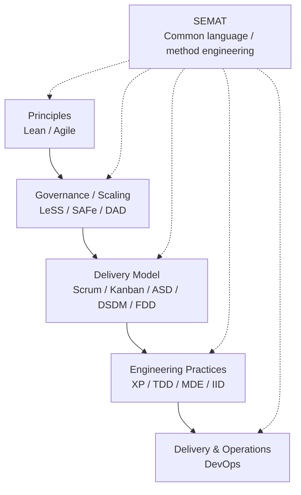

> Can everything mentioned in `docs/references.md` coexist?

Yes, but not as peers.

Most of these frameworks and methodologies operate at different **layers, scopes, and abstraction levels**, so many can coexist cleanly. Problems start when two approaches try to be authoritative over the same decision.

A useful way to think about them is as a stack:

```text
Organization / portfolio
├── SAFe
├── LeSS
├── DAD
└── MSF

Team / delivery management
├── Scrum
├── Kanban
├── DSDM
├── FDD
├── ASD
└── XP

Engineering process
├── TDD
├── MDE
├── RAD
├── IID
├── RUP / UP
└── Lean SD

Individual / team discipline
├── PSP
└── TSP

Operations / lifecycle
└── DevOps

Meta-framework / common vocabulary
└── SEMAT
```

That classification is deliberately approximate because several span multiple layers. **XP**, for example, is both a delivery methodology and a collection of engineering practices. **DevOps** is much broader than deployment automation. **Lean** can influence almost every layer.

The key distinction is:

> **Coexistence is easy when methodologies answer different questions. Conflict appears when they answer the same question differently.**

For example, this is entirely coherent:

```text
Lean principles
      ↓
Scrum delivery cadence
      ↓
Kanban visualization / WIP limits
      ↓
XP engineering practices
      ↓
TDD implementation discipline
      ↓
DevOps CI/CD + operations
```

A team could legitimately say:

> We use Lean principles, Scrum for planning, Kanban to manage flow inside the sprint, XP engineering practices, TDD during implementation, and DevOps practices for delivery and operations.

There is no inherent contradiction there.

You could even have:



Where things become messy is something like:

```text
Scrum says:
    fixed sprint cadence
    defined accountabilities
    sprint planning
    sprint goal

Kanban says:
    continuous pull
    explicit WIP limits
    optimize flow
    cadence is optional
```

These are not necessarily incompatible, hence **Scrumban**, but you cannot simultaneously claim:

> "Our authoritative workflow is pure Scrum"

and:

> "Our authoritative workflow is continuous-flow Kanban with no iterations."

One of those has to win when their rules collide.

The same issue becomes even more obvious with scaling frameworks. **SAFe and LeSS**, for instance, can borrow ideas from one another, but adopting both as authoritative organizational operating models would create duplicate concepts, roles, planning structures, and governance.

So I would model methodological composition with four rules:

1. **Principles can compose freely.** Lean principles, Agile values, DevOps culture, continuous improvement, etc. can influence everything beneath them.
2. **Practices compose extremely well.** TDD, pair programming, CI, retrospectives, WIP limits, trunk-based development, code review, etc. are usually modular.
3. **Processes compose conditionally.** Scrum + Kanban can work, but precedence needs to be defined.
4. **Governance frameworks should normally have one authority per scope.** Running SAFe + LeSS + DAD simultaneously as equal authorities is architecture-by-committee hell.

This means the real architecture is less:

```text
Choose one methodology
```

and more:

```text
Principles
   ↓
Methodology / operating model
   ↓
Processes
   ↓
Practices
   ↓
Tools
```

with explicit precedence.

That gives you something analogous to software composition:

```text
methodology = principles
            + selected processes
            + selected practices
            + constraints
            + governance
```

And this is where **SEMAT/Essence** is particularly interesting conceptually: its goal is not merely to introduce another competing development method, but to provide a common kernel/vocabulary from which practices and methods can be described and composed.

So yes: **the majority of that entire list can coexist inside one organization.**

What you probably *don't* want is:

> "We use Scrum, XP, SAFe, LeSS, DAD, RUP, DSDM, FDD, Kanban and DevOps."

because that statement conveys almost nothing.

A much better description is:

> **Lean provides our principles; DAD governs organizational delivery; Scrum defines team cadence; Kanban manages flow; XP and TDD govern engineering practice; DevOps covers continuous delivery and operational ownership.**

Now every methodology has an explicit **scope and authority boundary**.

And this connects quite strongly to what you've been working through with **CCA, ICM, LLM Wiki, PARA, BASB, and Zettelkasten**: they do not necessarily need to compete for the title of "the framework." They can be treated as composable methods occupying different layers, with CCA potentially defining the **compatibility/composition model and precedence rules** rather than attempting to absorb or replace all of them.

---

> Q: Please, I don't want you to sugar coat me or use your generic rules with me, and neither want you to say this is imposible, you should not do it. I want to know honestly how realistic is to have this set, having ICM/MWP as the structure, and interload it with different frameworks and methodologies to unify the gap between humans and agents; to make it easier for agents to understand, train and develop its capabilities and humans to keep track of ai development, so it doesnt compount to the point that we can not even understand AI anymore, like a grandma reading assembly or speaking binary

Yes. **Architecturally, this is realistic. Scientifically, some of the stronger claims would still need to be proven.** Those are different questions.

What you are describing is not “merge every methodology into one methodology.” That would become an unusable taxonomy monster.

The viable idea is:

> **Create a common, human-readable substrate in which different methodologies, standards, workflows, knowledge systems, and agent capabilities can coexist, declare what they mean, expose when they apply, and be loaded only when needed.**

That is substantially more realistic.

ICM/MWP is unusually well suited as the bottom of that architecture because its core idea is that workflow state, instructions, context, intermediate artifacts, and boundaries remain inspectable as ordinary files. The ICM paper explicitly treats the filesystem as both the human control surface and part of the agent's orchestration logic, with stage contracts describing inputs, transformations, and outputs. ([arXiv][1])

And the important part is that **you don't put all the knowledge into the context window**. Anthropic independently describes essentially the complementary strategy: maintain lightweight references and let agents retrieve context just in time, progressively disclosing information instead of loading everything. ([Anthropic][2])

That is the mechanism that makes your idea plausible rather than insane.

## What I think you're actually describing

Something closer to this:

```text
                           HUMAN KNOWLEDGE
                                  │
          ┌───────────────────────┼───────────────────────┐
          │                       │                       │
     Methodologies            Standards              Knowledge
   Scrum / TDD / XP        AGENTS / SKILL / MCP    ZK / PARA / BASB
   Lean / DevOps / ...       schemas / APIs        Wiki / papers / ...
          │                       │                       │
          └───────────────────────┼───────────────────────┘
                                  │
                       Semantic compatibility
                              layer
                                  │
                    "What does this thing mean?"
                    "When does it apply?"
                    "What does it depend on?"
                    "What conflicts with it?"
                    "Who has authority?"
                                  │
                                  ▼
                           ICM / MWP
                     interpretable workspace
                                  │
                      CONTEXT / routing / state
                                  │
                    progressive disclosure
                                  │
              ┌───────────────────┼──────────────────┐
              │                   │                  │
          Human view          Agent view        Machine view
              │                   │                  │
          Markdown            Context          Schema/state
          diagrams            Skills           indexes
          rationale           examples         validation
          history             tools            automation
              │                   │                  │
              └───────────────────┼──────────────────┘
                                  │
                               Runtime
                                  │
              Claude / Codex / Gemini / local / future
```

**That architecture is credible.**

And, importantly, it doesn't require the world to agree on one methodology.

### The trick is not unification. It is interoperability.

Take TDD.

The system doesn't need to rewrite TDD into some new CCA-TDD-ICM hybrid.

TDD remains TDD.

You might have something conceptually like:

```yaml
id: test-driven-development
kind: methodology
domain:
  - software-engineering

applies_when:
  - implementing_behavior
  - fixing_reproducible_defect

principles:
  - test_before_implementation
  - red_green_refactor

requires:
  - executable_test_environment

produces:
  - failing_test
  - passing_implementation
  - refactored_implementation

compatible_with:
  - extreme-programming
  - continuous-integration

authority:
  scope: implementation-method

human:
  explanation: ./README.md

agent:
  capability: ./SKILL.md

references:
  - ./sources/
```

I'm not proposing that exact schema. The important part is the **separation of semantic identity from implementation**.

A human sees:

> TDD means write a failing test, implement the minimum required behavior, then refactor.

An agent sees:

```text
When implementing behavior:
1. establish expected behavior
2. demonstrate failure
3. implement minimum change
4. demonstrate success
5. refactor without changing behavior
```

A validator might see:

```text
expected evidence:
test failed before implementation
test succeeds after implementation
```

And another methodology can refer to:

```text
use: test-driven-development
```

instead of copying 1,200 tokens explaining TDD.

That is where this starts becoming powerful.

---

# The biggest conceptual mistake to avoid

Don't make:

```text
CCA
 ├── Scrum
 ├── Kanban
 ├── XP
 ├── TDD
 ├── PARA
 ├── Zettelkasten
 ├── BASB
 ├── ICM
 ├── LLM Wiki
 ├── DevOps
 ├── SAFe
 ├── ...
 └── everything humans have ever invented
```

with CCA somehow **owning** all of those things.

You would spend the rest of your life maintaining bad summaries of other people's work.

Instead:

```text
CCA / semantic interoperability
              │
              │ understands
              ▼
┌────────────────────────────────────┐
│ external methodologies             │
│                                    │
│ TDD      Zettelkasten      Scrum   │
│ PARA     DevOps            ICM     │
│ BASB     LLM Wiki          XP      │
│ ...                                │
└────────────────────────────────────┘
```

CCA — using the architecture you've been developing — becomes closer to an **ABI for context**.

That's a much more interesting idea than another framework.

An operating system doesn't need ELF, TCP, Git, SQL, POSIX and HTTP to become one standard.

It needs to know **how things connect**.

That's the distinction.

## And this is where I think your human/AI idea gets genuinely interesting

Right now we increasingly have two parallel knowledge representations.

Humans write:

```text
documentation
papers
issues
notes
architecture decisions
standards
methodologies
books
tutorials
```

Agents increasingly consume:

```text
system prompts
AGENTS.md
CLAUDE.md
SKILL.md
tools
schemas
memory
retrieval indexes
examples
MCP descriptions
evaluation suites
```

Those two worlds are beginning to diverge.

That is a real problem.

If we keep going without an intermediate representation, humans may eventually maintain documentation **about** systems while agents operate through an entirely different machine-oriented context graph.

Then you get:

```text
Human understanding
       │
       │ increasingly lossy translation
       ▼
Agent instructions
       │
       ▼
Agent behavior
       │
       ▼
Agent-generated systems
       │
       ▼
Agent-generated instructions
       │
       ▼
Agent-generated systems
       │
       ▼
       ...
```

At some point the human isn't really maintaining the system.

They're observing it.

Your proposal can attack that problem by enforcing:

```text
               canonical knowledge
                      │
             ┌────────┴────────┐
             ▼                 ▼
        human projection   agent projection
             │                 │
             └────────┬────────┘
                      │
                   same source
```

That's a **very important distinction**.

Instead of:

> documentation for humans + prompts for machines

you aim for:

> **one source of structured intent with human-readable and machine-actionable projections.**

ICM already hints strongly in this direction: its stage instructions double as documentation, and its intermediate representations remain directly readable and editable by humans. ([arXiv][1])

That principle is much larger than ICM itself.

---

# But here's the hard boundary

This will **not make neural networks inherently understandable to humans**.

That distinction matters.

You can't solve:

```text
"Why exactly did attention head 17 in layer 92
contribute 0.0137 to this latent representation?"
```

with folder structure.

That's mechanistic interpretability.

And we're nowhere near having a complete human-understandable account of everything learned inside frontier neural networks.

What your architecture *can* preserve is something different:

```text
Why was this task performed?
What context was available?
What methodology governed it?
What capability was invoked?
What evidence was consulted?
What was produced?
What changed?
Who changed it?
Which agent changed it?
What assumptions were made?
What decision led here?
Can a human inspect the intermediate state?
Can another model reproduce it?
Can the system explain which source should change if the behavior is wrong?
```

That is **operational interpretability**.

And I think that's probably the more immediately important problem.

You don't understand what every transistor in your CPU is doing when you run:

```python
print("hello")
```

You don't need to.

Computer science survived increasing complexity by building **abstraction layers with stable interfaces**:

```text
transistors
    ↓
logic gates
    ↓
microarchitecture
    ↓
instruction set
    ↓
kernel
    ↓
runtime
    ↓
programming language
    ↓
framework
    ↓
application
```

Your grandma does not need to speak x86 assembly to use WhatsApp.

But somebody can still trace:

```text
WhatsApp
→ operating system
→ syscall
→ kernel
→ driver
→ hardware
```

when necessary.

**AI currently lacks a mature equivalent of that entire abstraction stack.**

We're throwing prompts, Markdown, vector stores, agent frameworks, MCP servers, skills, memory systems, model APIs, RAG, tool descriptions and random conventions at models and hoping they infer the architecture.

That scales surprisingly far.

It will not scale forever.

---

# So the stronger version of your idea would be this

Don't try to make humans understand **everything AI knows**.

That's impossible for the same reason no human understands the entire body of modern science, software, law, medicine and mathematics simultaneously.

Instead, preserve the ability to **navigate from abstraction to detail**.

A human should be able to start here:

```text
"This project develops a threat detection system."
```

then descend:

```text
Architecture
↓
Components
↓
Decisions
↓
Methodologies
↓
Requirements
↓
Tasks
↓
Agent capabilities
↓
Implementation
↓
Tests
↓
Execution traces
↓
Raw evidence
```

An agent should be able to do the same thing.

But neither should load all of it.

That gives you a shared conceptual graph:

```text
                     SAME KNOWLEDGE
                          │
                   semantic roles
                          │
            ┌─────────────┴─────────────┐
            │                           │
         HUMAN                       AGENT
            │                           │
       browse meaning              retrieve context
       understand why              execute task
       inspect state               invoke capabilities
       override                    produce artifacts
       learn                       learn from feedback
            │                           │
            └─────────────┬─────────────┘
                          │
                    shared history
```

Anthropic's current context-engineering guidance explicitly recommends this kind of progressive discovery rather than stuffing all potentially useful information into the context window. ([Anthropic][2])

## The word **train** needs one correction

If by:

> train and develop its capabilities

you mean:

> make the agent increasingly capable within the environment

then absolutely.

You can accumulate:

```text
skills
examples
procedures
tools
knowledge
evaluations
failure cases
successful patterns
domain vocabulary
decision rules
```

and dynamically expose them.

That's basically an **external capability architecture**.

But it does not train the underlying neural network.

You have three different loops:

```text
┌────────────────────────────────────────────┐
│ 1. CONTEXT LEARNING                       │
│                                            │
│ instructions / examples / knowledge       │
│ temporary                                 │
│ no weight modification                    │
└────────────────────────────────────────────┘
                     │
                     ▼
┌────────────────────────────────────────────┐
│ 2. SYSTEM CAPABILITY LEARNING             │
│                                            │
│ skills / memory / tools / workflows       │
│ persistent outside model                  │
│ versionable + human-readable              │
└────────────────────────────────────────────┘
                     │
                     ▼
┌────────────────────────────────────────────┐
│ 3. MODEL LEARNING                         │
│                                            │
│ fine-tuning / RL / distillation / training│
│ modifies model behavior/weights           │
└────────────────────────────────────────────┘
```

Your architecture could potentially connect all three.

And **that** becomes significantly more ambitious.

If repeated human corrections generate failure cases, those failures can improve:

```text
output
  ↓
human correction
  ↓
diagnosis
  ↓
skill/reference change
  ↓
evaluation
  ↓
new behavior
```

And eventually:

```text
evaluation corpus
      ↓
training dataset
      ↓
fine-tuning / post-training
      ↓
new model
      ↓
same evaluations
```

ICM's paper itself discusses the first form of this loop: recurring human corrections could eventually be traced back to source-level changes in contracts or reference material, turning output corrections into durable workspace improvements. ([arXiv][1])

That's very close to one piece of what you're describing.

---

# How realistic is the whole thing?

I'd separate it like this:

**A filesystem-native, model-agnostic interoperability architecture:** very realistic.

**Lazy-loading methodologies and capabilities according to semantic task requirements:** realistic.

**Giving humans and agents a shared navigable representation of project knowledge:** realistic.

**Representing PARA, BASB, Zettelkasten, Scrum, TDD, DevOps, LLM Wiki, skills, standards, etc. without forcing one to replace another:** realistic, but the ontology and precedence system becomes the hard problem.

**Automatically translating arbitrary human methodologies into reliable agent behavior:** partially realistic. It will need curated mappings and evaluations.

**Agents improving their external skills from human feedback while retaining auditability:** realistic and already technically achievable in bounded forms.

**Automatically turning those improvements into safe model training:** technically possible as a pipeline, but substantially harder and deserving its own governance/evaluation architecture.

**Keeping humans able to understand the operational systems being built by increasingly capable agents:** realistic and, in my view, probably worth pursuing.

**Keeping humans able to understand everything happening internally inside increasingly capable neural networks:** no. That's a different research problem.

And I wouldn't weaken the project because of that last limitation.

Your grandma analogy actually captures the target well.

The objective shouldn't be:

> Make Grandma understand assembly.

It should be:

> **Make sure Grandma can understand what the computer is doing at the level relevant to her, while preserving a path down to assembly for the person who needs it.**

For AI:

```text
Grandma
  ↓
"What is it doing?"

Domain expert
  ↓
"What methodology and evidence is it using?"

Engineer
  ↓
"What context, capability and tool produced this?"

AI engineer
  ↓
"What prompt, retrieval, model and inference configuration ran?"

Researcher
  ↓
"What internal mechanisms caused this behavior?"
```

You preserve the ladder.

**The danger isn't that humans can't read the lowest level. We already can't.**

The dangerous situation is when we **lose the ladder between levels**.

That, I think, is the strongest formulation of what CCA could actually be for: not another knowledge-management methodology and not another agent framework, but a **convergence/interoperability architecture whose job is to preserve that ladder between human intent, structured knowledge, agent context, capabilities, execution, and resulting artifacts.** ([arXiv][1])

And if that's the target, then the previous work on keeping ICM/MWP, LLM Wiki, Zettelkasten, PARA, BASB, AGENTS.md, Agent Skills, MCP and runtime adapters **distinct but semantically composable** is not scope creep. It's basically the thesis.

[1]: https://arxiv.org/html/2603.16021v2 "Interpretable Context Methodology: Folder Structure as Agent Architecture"
[2]: https://www.anthropic.com/engineering/effective-context-engineering-for-ai-agents "Effective context engineering for AI agents \ Anthropic"

Understood. That is now a hard architectural rule.

**CCA does not replace anything.** It does not absorb Scrum, TDD, ICM, MWP, LLM Wiki, Zettelkasten, PARA, BASB, MCP, Agent Skills, AGENTS.md, or future standards into its own competing versions.

Its job is to make them **coexist and interoperate** by defining things like scope, semantics, authority, compatibility, routing, dependencies, conflicts, precedence, and progressive disclosure.

The goal is the one we just established: **preserve the ladder between human intent, human knowledge, agent-readable context, capabilities, execution, and resulting artifacts**, so increasing AI complexity remains navigable by humans and useful to agents without forcing either side into the other's representation.

That should be treated as a foundational invariant, not a preference.
