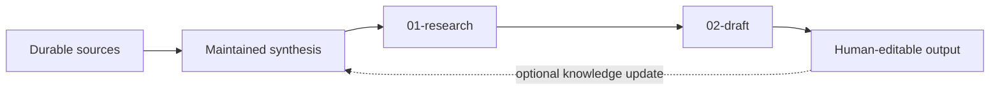

# Workspace forms

Forms are design heuristics, not compatibility requirements. Choose the smallest shape that improves routing or maintenance. Preserve an existing ICM or LLM Wiki implementation before applying a CCA-preferred form.

## 1. Pipeline

Use for sequential work with explicit handoffs and review gates. When ICM compatibility is claimed, preserve ICM naming and contracts.

```text
workspace/
├── AGENTS.md                 # optional portable guidance
├── CLAUDE.md                 # native ICM Layer 0 when applicable
├── CONTEXT.md
├── stages/
│   ├── 01-research/
│   │   ├── CONTEXT.md
│   │   ├── references/
│   │   └── output/
│   ├── 02-draft/
│   │   ├── CONTEXT.md
│   │   ├── references/
│   │   └── output/
│   └── 03-produce/
│       ├── CONTEXT.md
│       ├── references/
│       └── output/
└── [stable shared references/configuration]
```

Use when the same multi-step workflow runs repeatedly and stage boundaries make review or context isolation clearer.

Failure modes: multi-job stages, missing/oversized contracts, downstream-to-upstream back-references, and quality rules copied from old outputs instead of canonical references.

## 2. Umbrella

Use when several independent workspaces share a small amount of top-level guidance.

```text
org/
├── AGENTS.md
├── CONTEXT.md
├── shared/
├── weekly-report/
├── client-onboarding/
└── research-digest/
```

Members may consume shared canonical references. Avoid coupling members to one another's internal working outputs.

## 3. Record library

Use for many same-shaped records such as clients, projects, people, incidents, or sessions.

```text
clients/
├── AGENTS.md
├── index.md
├── record-template/
├── acme-corp/
└── globex/
```

Use an index when it materially improves navigation. Do not force a fixed record schema onto an existing project that already has one.

## 4. Knowledge bundle

Use for maintained knowledge that compounds across sessions.

The LLM Wiki pattern does **not** require one concrete tree. Discover and preserve an existing wiki's own schema.

When starting fresh and the user wants an opinionated CCA-hardened layout, one useful option is:

```text
brain/
├── AGENTS.md
├── raw/
├── wiki/
│   └── index.md
└── log.md
```

Additional entity/concept/source/synthesis directories and metadata are optional implementation choices.

Failure modes: isolated summaries instead of integrated synthesis, invented provenance, silent contradiction overwrite, and indexes that drift from the knowledge they route to.

## 5. Context map

Use when the primary need is orientation across systems, teams, projects, decisions, workflows, or other linked entities.

```text
map/
├── AGENTS.md
├── index.md
├── areas/
├── workflows/
├── decisions/
└── interfaces/
```

Markdown links and lightweight metadata can express relationships without requiring a graph database. Add stronger graph infrastructure only when scale or query needs justify it.

## Composition

Forms may compose when the work naturally crosses boundaries. A common example is a maintained knowledge base feeding an ICM-compatible pipeline.



Do not create the reverse dependency merely for symmetry: pipeline stages may consume canonical knowledge, but shared knowledge should not depend on a downstream stage's internals unless the workspace explicitly defines that maintenance operation.
